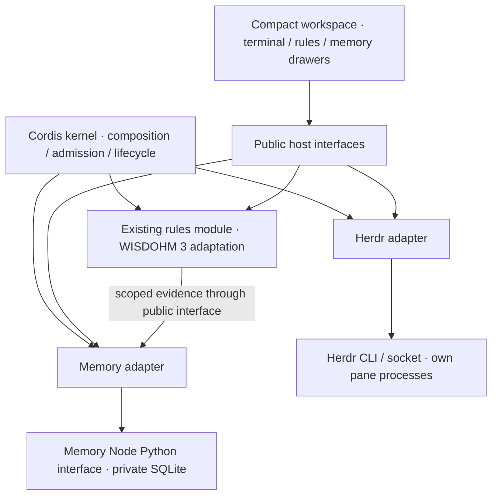

# Herdr, WISDOHM 3, Memory Node and compact workspace

Status: **implementation in slices**. Reviewed 2026-11-16. Launcher activation,
lean boot guidance and the compact terminal dock (U1) are complete. Broader compact
UI and product integrations remain planned. The 2026-11-16
[surface stability audit and milestone S](herdr-wisdohm-memory/surface-stability.md)
now prioritizes project navigation and retained view state before further UI integration.
Work in `_devLAB-refactored`. Maintain status here; historical
simplification results stay in [the simplification plan](simplification.md).

Planning method: archived Matt Pocock **codebase-design** and **to-spec** skills,
read locally on 2026-11-15. Use deep modules, small public interfaces and tests
through the caller's seam. Local Markdown is the established tracker; no issue
publication, Git setup, skill installation or old execution runtime is needed.

## Related standalone factory

The requested [preimplementation layer](herdr-wisdohm-memory/preimplementation.md)
is implemented in the existing project/preview capabilities (2026-11-16): staged
task folders, registry links, sandboxed prototypes and reviewed filesystem promotion.
Its first catalog prototype remains a proposal; S7 and the remaining integration
slices keep their existing status. This does not reconnect the extracted planner.

The separately requested [Software Factory](../../_projects/software-factory/README.md)
is implemented in `_projects/software-factory/`. It owns the standalone steps engine,
multi-agent orchestration, feature-intent/specification pipeline and editable per-step
engines. It includes isolated Memory Node/Intelligence and adapted WISDOHM integrations;
its optional Cordis adapter is tested but is not installed in this host. This plan continues
to own live Herdr, WISDOHM, Memory Node and compact-workspace integration. Share the existing terminal/rules/memory interfaces; do not introduce a
second scheduler, ownership registry or terminal owner through either plan.

## Problem statement

The user wants the lean refactored DevLab available from the Linux top bar,
Herdr's real terminal interface inside the workspace, a visible WISDOHM 3 rules
layer and a usable Memory Node integration. Stacked toolbars take space from
actual work. Future agents must preserve the simplified architecture and resource
owners rather than rebuild frameworks around each capability.

## Solution

Keep the Cordis microkernel and current public plugin flow. Offer a compact
workspace with one contextual header per surface, collapsible sections and
drawers for secondary controls. Connect Herdr through its supported interface;
reuse Memory Node's governed Python core. Adapt WISDOHM 3's discipline to the
existing rules module and canonical ownership, with visible differences and
truthful readiness. Ship working vertical slices, each with refusal and recovery
behavior, rather than enabling a complete orchestration runtime at once.

## User stories

1. As the owner, I open the refactored app from the existing DevLab top-bar icon.
2. As the owner, I retain the previous window and drafts when switching editions.
3. As a terminal user, I see one compact contextual control row for a single pane.
4. As a terminal user, I expand secondary controls without losing focus or output.
5. As a terminal user, I combine, rename, rearrange, resize and select multiple panes.
6. As a terminal user, I can still discover ownership, isolation and error status.
7. As a keyboard user, I open/close sections and drawers with focus and Escape support.
8. As a workspace user, I collapse sidebars and drawers without restarting resources.
9. As a Herdr user, I see available sessions, panes and connection state in DevLab.
10. As a Herdr user, I explicitly attach its real TUI and detach without killing work.
11. As the owner, I control which Herdr sessions and operations DevLab may access.
12. As a terminal user, I see when Herdr process ownership differs from DevLab's.
13. As the owner, I inspect effective WISDOHM rules, sources, roles and mode.
14. As an agent, I receive the current boot contract and owner scope before changes.
15. As the owner, I review rule changes without memory text silently granting authority.
16. As a memory user, I browse real records, search, inspect revisions and see provenance.
17. As an agent, I remember and recall evidence only within host-assigned grants.
18. As the owner, I approve/reject shared proposals and detect stale reviews.
19. As a memory user, I forget content and its derived copies through one governed path.
20. As a memory user, I compact selected same-scope evidence with explicit lineage.
21. As an agent, I receive bounded, escaped context with included IDs and omissions.
22. As the owner, I distinguish working notes, durable evidence and trusted host policy.
23. As a maintainer, I see errors, disconnected features and pending integration honestly.
24. As a maintainer, I verify each slice without changing the original projects or stores.

## Current evidence and decisions

| Subject | Verified position / decision |
| --- | --- |
| Host | Cordis-backed kernel and eight live backend plugins remain. The 27 original canonical owners are retained; four standalone browsing owners bring the current total to 31. Those features are not installed in this live profile. No kernel replacement. |
| Desktop | Existing drawer selected the new window at `http://127.0.0.1:4323/`; original window preserved. Separate Electron profile; reuse installed desktop shell. See activation evidence below. |
| Herdr | Installed binary reports `0.9.3`. Upstream manifest observed `0.9.5`; these are different inputs. Pin and inspect the chosen binary's schema before integration. No upgrade performed. |
| License | Upstream Herdr LICENSE and manifest declare Apache-2.0. Integration/modification/commercial redistribution permitted subject to license and notice conditions. Packaged dependency/asset notices need a release-specific inventory. |
| Memory Node | Separate implemented Python/SQLite core and adapters, with four durable kinds, host-bound Access, transactions, history, review, erasure and bounded XML. Fresh tests: 25 Python + 6 JS passed. Not connected to DevLab. |
| Memory UI | Its HTTP UI has `frame-ancestors 'none'`, separate owner/agent credentials and fixed local bindings. Do not embed by disabling that policy or expose its owner key to DevLab browser code. |
| WISDOHM 3 | Template defines settings, roles, preflight and a legacy schema-v4 memory integration. It currently selects manual mode and permits agent settings edits. Neither setting becomes DevLab authority by copying it. |
| Existing rules | DevLab's retained WISDOHM 2.6 inspection reports invalid authority/missing operational memory. Retain provenance; render WISDOHM 3 as a distinct reviewed source until adapted. |
| Simplification | Preserve preceding removal of 5 source files / 659 application+CSS lines. This is a baseline, not a ban on justified functionality or a speed measurement. |

## Implementation decisions



This is proposed topology, not a diagram of installed new plugins. Existing
terminal, editor and preview owners remain responsible for their live resources.

### Deep modules and ownership

- Keep one public interface per capability; callers and behavior tests cross it.
  Kernel composition contains selection/grants, not Herdr, rules or memory logic.
- Reuse terminal session transport/rendering, rules inspection, graph layout and
  host menus. Proposed additions are bounded Herdr and memory backend modules plus
  a memory UI module, introduced only with their first working slice. No generic
  integration bus, provider factory or second scheduler.
- The Herdr module owns discovery, bounded socket/CLI transport and detach cleanup.
  Herdr owns its inner pane processes. An outer DevLab PTY must not also claim
  their lifecycle or relabel an external Herdr server as Strict-isolated.
- The memory module is a thin host-bound adapter to the existing Python interface.
  Python owns SQLite, validation, promotion, revisions and erasure. Do not translate
  its implementation into TypeScript or import its private storage code.
- WISDOHM adaptation stays with the rules capability. The existing canonical
  ownership reader remains the file-scope authority. A second editable registry,
  boot entry or memory promotion pipeline is forbidden.
- Add canonical owner definitions and declared dependencies at each implementation
  slice; regenerate projections through the existing writer. Never hand-edit grants
  or rewrite active terminal policies to make a new plugin fit.

### Compact UI contract

- Target the terminal dock's workspace toolbar plus repeated pane toolbar. For one
  pane, merge global actions and pane identity/actions into one contextual header.
  For multiple panes, retain a compact group strip only where group selection/layout
  needs it; each pane retains a minimal identity/status handle. No repeated labels.
- Use expanded, compact and collapsed presentation. Collapsed sections leave a
  discoverable labelled handle; keep status/errors visible or announce them. Use
  the existing project-header disclosure and Hood drawer patterns as references,
  while retaining usable hit areas and visible keyboard focus.
- Move infrequent ownership, fork, reorder and diagnostic controls into the existing
  actions menu/drawer. Retain new terminal, focus and important failure indicators.
  Expose every retained action through keyboard or an explicitly labelled control.
- Store view preferences separately from terminal/session identity. Hiding a view
  must not unmount a retained owner, launch a hidden shell, replace iframe DOM,
  discard editor text, or leave a hidden pane holding input/resize ownership.
- Map every current control before deletion. Measure chrome height before/after at
  1440, 820 and 390 widths. Single-pane acceptance: one context row, more content
  height, no horizontal overflow and all prior actions reachable. Exact pixel
  density is selected in the existing UI prototyping workflow, not hard-coded here.

### Herdr interface and process safety

Product direction clarified by the user on 2026-11-16: Herdr belongs inside
DevLab as its own managed workspace runtime, a “mini operating system” for project
work. Attaching to the user's general desktop Herdr instance is not the default
integration. This is a planned ownership/isolation contract, not an installed
runtime or a claim of a separate OS kernel.

- H0 first pins the installed binary/schema/notices and establishes a dedicated
  DevLab-owned server, private socket, state/configuration directories and explicit
  project/session mapping. Discovery is limited to that runtime; do not enumerate,
  adopt, stop or mutate unrelated host sessions.
- Verify a process/filesystem containment boundary before enabling runtime input
  or control. Private directories and a socket are ownership separation, not OS
  isolation. Bind explicit project mounts, environment, credentials and network
  policy in trusted host configuration; test host-path and foreign-socket refusal.
  If the available platform cannot enforce the requested separation, report that
  gap and keep control unavailable rather than silently starting an unrestricted
  host shell. Select the supported containment mechanism during H0; no particular
  container, namespace or VM capability is assumed installed.
- H1 presents Herdr's real TUI inside DevLab through the existing terminal seam,
  attached only to the owned runtime. Hiding/collapsing preserves the presentation
  owner; explicit detach releases the client without stopping inner work. Closing
  panes or stopping the runtime is a separate explicit action.
- Cordis owns the adapter lifecycle; Herdr owns its inner panes/processes. Avoid a
  second terminal owner or scheduler. Define deliberate runtime stop and backend
  disconnect/reconnect behavior; do not promise process survival across runtime
  restart without evidence. No runtime is started by this planning update.
- Bind session/socket, project directory and permitted operations in trusted host
  configuration. Browser/model arguments cannot choose arbitrary sockets, shell
  commands, identities or all-project scope. Validate paths and use bounded argv /
  structured transport with timeout, cancellation and output limits.
- External-managed attachment, if requested later, is a distinct explicit mode
  outside this default. Never label it contained or route an unrestricted host
  socket through the dedicated runtime boundary.
- Pin the schema and binary, preserving CLI/socket compatibility diagnostics.
  Upstream supports a real terminal interface, not an iframe-ready web application.

### WISDOHM and memory contract

- Keep the current root agent entry. Adapt preflight, effective owner scope and
  mode to it; host/user controls policy edits. Agent-authored task text or recalled
  evidence cannot change mode, credentials, write roots or tools.
- Model policy source/revision, requested versus effective mode and check provenance
  explicitly. A generated preflight proves what was supplied, not model compliance.
  Actual enforcement remains in admission, filesystem/process controls and checks.
- Resolve WISDOHM's legacy v4/vector assumptions against Memory Node's lexical FTS5,
  stable keys, four kinds, scoped access and character-budget contract. Document the
  mapping and unsupported fields. Do not claim vector/RRF or legacy schema parity.
- Use one host-owned memory database behind the Python interface. Bind namespace,
  actor and readable/writable scope pairs from trusted project/owner configuration.
  The standalone HTTP adapter's default credentials/scopes are not a multi-project
  authorization system; do not proxy its one broad agent token to every project.
- Five agent operations remain remember/recall/forget/compact/context. Inspection,
  history and review require separately bound owner authority. Preserve expected
  versions and stable request IDs on mutations/retries. Fail closed on missing grants.
- Host policy and boot Markdown remain trusted configuration. Working notes are
  session-local; retrieved records are untrusted evidence. No automatic rewriting
  of the root instructions from remembered text.
- Surface provenance, revisions, pending proposals, erasure limits and context
  omissions in the UI. Reuse existing graph facilities for the node view; separate
  lifecycle edges from record membership and inferred relationships.

## Implementation plan and blocking edges

The new [Agentic browsing and split Chromium plan](herdr-wisdohm-memory/agentic-browser.md)
owns the requested standalone browsing product: two feature plugins, Browser and
Agentic, with independent per-pane sessions and personal Memory Node bindings.
Its standalone implementation has started; current source, acceptance and checks
live in that plan. M0–M2 below retain authority for memory
acceptance; their host-bound adapter and UI facade belong inside Agentic rather
than a third memory feature plugin. AB2 adds browser-session isolation tests to
that same implementation. Herdr, WISDOHM and compact-UI scope remain here.

Each planned row is a demoable vertical slice across its affected layers, not a
request to build all backends before all UIs. A slice may have sequential owner
steps; each implementation step declares one owner and exact writes at preflight.

| ID / status | Blocked by | End-to-end delivery and acceptance |
| --- | --- | --- |
| D0 **done** | None | Existing top-bar DevLab action shows refactored app, separate profile, old window preserved; local UI service enabled; readiness and drawer binding verified. [Login startup-cycle recovery](#d0-startup-cycle-recovery--2026-11-16) verified on 2026-11-16. |
| G0 **done** | None | Root entry → BOOT → mandatory lean invariants; preflight/continuation and compact UI conduct documented. Existing mechanical checks remain the enforcement evidence. |
| P0 in progress (files/source verified; live activation pending) | G0 | Every project has local agent context and a DevLab introduction; new terminal defaults to that project's root. All 18 current roots populated without replacing existing instructions. Creation/Open Folder provisioning and startup notice verified in disposable hosts; live backend restart deferred to preserve current previews. [Evidence](#per-project-bootstrap-context--2026-11-16). |
| U1 **done** | None | One 28px contextual header replaces two 36px rows. Controls collapse per project; owner/status and actions disclosure remain visible. Build, nine source checks, lifecycle at 1440/820 and comparison at 390 passed; evidence below. |
| U2 in progress | U1, S2 | Consistent compact/collapsed sidebars and contextual drawers across project, terminal and Hood surfaces. Compact icon/label catalogue and two yellow accessible resize dividers are detailed in S7; broader Hood/drawer acceptance stays here. Keyboard/Escape/focus, independent panel state and draft/preview retention pass. |
| S in progress; S0 audit done | U1 | [Stable surfaces and canvas terminals](herdr-wisdohm-memory/surface-stability.md): newest navigation intent wins, per-project view/selection restoration, terminal warning/flicker diagnosis, grouped dimension-aware alignment, mouse resize and text −/+ controls. First S1/S2/S4 fixes verified: stale navigation, ordinary surface/Build retention and overlapping alignment. Broader slice acceptance remains open; see the implementation evidence. |
| H0 in progress — verified; live activation pending | None | Pin Herdr version/schema/notices; establish the DevLab-owned runtime contract and verify containment on disposable state before input/control. Private socket/state/configuration, explicit project bindings and read-only connection/session UI; host paths/foreign sockets refused and unrelated host sessions untouched. Unsupported containment keeps control unavailable. |
| H1 in progress — verified; live activation pending | H0; retained S1/S2/S3 behavior verified for this view | Explicit TUI attach/detach to the dedicated DevLab-owned runtime in a separate Herdr view through the existing terminal seam; canvas terminal creation remains supported. Select/display ownership; repeated attach avoids duplicate clients; hide/show preserves work; server disconnect/reconnect tested on a disposable session. S9 verifies coexistence. |
| H2 in progress — verified; live activation pending | H1; immutable host policy (W1 editing remains separate) | Scoped local create/split/focus/resize/input/rename/close operations from UI. Dedicated ownership, policy checks, cancellation and cleanup verified; external session mutation and Strict bypass rejected. No false process-survival claims on server restart. |
| W0 planned | None | Read-only WISDOHM 3 UI showing reviewed rules, sources, revision, roles and requested/effective mode, beside legacy inspection. Import as data; no overwritten root, new executor or fabricated receipts. |
| W1 planned | W0 | Host-authoritative boot/preflight binding and guarded policy changes, with owner scope and actual check provenance shown in UI. Forged mode/grants rejected; existing checks cannot be relabelled as current receipts. |
| M0 in progress | None | DevLab memory connection and read-only records/search/detail node view through a host-bound adapter. Project A cannot read B; owner/token data absent from browser; unavailable/mismatched memory handled. No default-scope fallback. |
| M1 in progress | M0 | Remember/update/history and owner review queue from UI and agent interface. Stable keys, request IDs, stale-version refusal, separate review authority and retry/restart behavior demonstrated with disposable records. |
| M2 in progress | M1 | Forget/compact/context UI with scope-preserving lineage and visible included/omitted IDs. Erase revisions/queued/derived copies; retry cannot resurrect content; bounded XML with hostile text and control characters passes. |
| I0 planned | W1, M2 | WISDOHM preflight consumes trusted policy plus scoped Memory Node evidence; user can inspect its context and provenance. Cross-project leaks, instruction promotion and concurrent policy/memory races rejected. One store and one root authority remain. |
| Q0 planned | U2, H2, I0, S9 | Integrated four-preview/editor/terminal/Hood/memory evaluation at 1440/820/390; no draft loss, duplicated processes, orphan listeners or inaccessible actions. Review source/dependency growth and publish exact functionality/limits. |

Implementation priority: **S1 → S2 → S3** after the reproduced navigation,
surface-restoration and alignment findings. H0 discovery and W0/M0 retain their
independent frontier; H1 uses the stable navigation/presentation contract. U2
continues through S7 for the two left panels and its remaining Hood/drawer scope.
The exact live Codex warning and spontaneous blink/jump cause remain unverified;
the first fixes close the reproduced paths documented in S, not an unobserved Codex incident.
The rows may proceed sequentially; this plan does not launch parallel agents.
The browsing product's current frontier and acceptance live in its own plan.
M0–M2 have partial standalone adapter/UI work inside Agentic: private bindings,
remember/update/recall/context/forget and retry/CAS/erasure checks. DevLab
connection, node view, history, owner review and compaction UI remain unfinished;
none of M0–M2 is complete. The U/H/W/I/Q rows retain their statuses and acceptance.

## Feature coverage and deliberate later work

| Feature family | Delivery |
| --- | --- |
| Herdr real TUI, workspace/tab/pane list and connection state | H0–H1 |
| Local splits, input, focus, resize, zoom, labels and explicit close | H2 |
| Herdr CLI/socket agent state, subscriptions and event recovery | H2, bounded to supported pinned methods; stale state shown |
| WISDOHM rules, owners, roles, effective settings and preflight | W0–W1 |
| WISDOHM memory-context inspection | I0 |
| Memory topology, records, search, revisions and provenance | M0–M1 |
| Review, forgetting, compaction, context and agent operations | M1–M2 |
| Shrinkable headers, sections and drawers | U1–U2 |
| Herdr remote SSH machines, worktree mutations, marketplace install and updater | Later explicit slices; outside the first local release. Existing remote sessions remain untouched. |
| Automatic agent execution, provider/model orchestration and bounded multiagent browsing | Requested in the separate [browsing plan](herdr-wisdohm-memory/agentic-browser.md); standalone fake inspection runs now exist, with real-provider/multiagent work still planned. DevLab remains disconnected. Automatic memory extraction remains later work. |
| Legacy memory migration, vector retrieval, cloud/multi-user deployment | Later separate designs and data-copy evaluations. No live DB migration. |

## Testing decisions

Test public behavior through the highest existing seam: DevLab's HTTP/client and
actual retained UI for host integration, Herdr's pinned public protocol for its
adapter, and Memory/AgentTools for the Python core. Avoid mock-only confidence,
private-import tests and tests asserting a particular file split or line count.

- UI: characterize current action inventory, then verify merged controls, keyboard
  focus, expand/collapse, hidden-pane launch protection, input/resize handoff and
  editor/iframe/session identity. Use existing lifecycle and minimap/browser fixtures.
- Herdr: isolated session, real TUI attach/detach, explicit control refusal, timeouts,
  stale protocol, cancel, server restart and no killing unrelated pane processes.
- Memory: rerun current core tests, then host identity/scope mapping, multi-project
  authorization, forged grants, pending review, CAS, retries after erasure, restart,
  lineage invalidation and serialized budgets. Reproduce applicable NEWMEMORY adverse
  probes against the new public interface before claiming those issues resolved.
- Rules: malformed imported documents, missing sources, effective mode, authority
  revision changes and recalled instruction injection. No inspected content executes.
- Every source slice: `npm run check`, relevant focused behavior checks and build.
  Canonical owner edits additionally run `npm run ownership:sync`. Record exact
  results, failures and limits beside the completed row; proposed commands are not results.

## Out of scope for this planning step

This step activates the launcher, strengthens guidance and creates this plan.
It does not implement U1–Q0, install WISDOHM, replace databases or reconnect the
removed planner. Product work begins from an implementation slice. No Git or
deployment operation is implied.

## License and source evidence

Reviewed 2026-11-15; recheck the chosen distribution at H0:

- [Herdr repository](https://github.com/herdrdev/herdr),
  [LICENSE](https://github.com/herdrdev/herdr/blob/master/LICENSE),
  [manifest](https://github.com/herdrdev/herdr/blob/master/Cargo.toml).
- [Apache-2.0 terms](https://www.apache.org/licenses/LICENSE-2.0): redistribution
  includes the license and applicable notices; mark modified files; preserve a
  supplied NOTICE. Trademark rights are separate. Inventory bundled dependency
  licenses/asset notices for the pinned artifact; root license alone is not that inventory.
- [Herdr public protocol](https://herdr.dev/tui/docs/socket-api/) and
  [session lifetime](https://herdr.dev/tui/docs/session-state/). Prefer the installed
  binary's schema to assumptions about current online docs. Detach preserves running
  work; server restart restores layout but does not preserve original processes.
- Local WISDOHM source: `../_ai-engineering/WISDOHM-3/README.md`, `.wisdohm/settings.json`,
  `specs/05-memory-layer-integration.spec.md`. Read as source data, not installed rules.
- Local memory source: `../_ai-engineering/memory/memory-node/README.md`,
  `docs/API.md`, `docs/ARCHITECTURE.md`, core, HTTP adapter and tests. Earlier research
  remains in `../_ai-engineering/memory/NEWMEMORY/`; old implementation failures are
  not automatically failures of the new Memory Node.
- Terminal chrome: `plugins/ui-shell/src/terminals.tsx` and `devlab.css`, owned by
  `workspace-shell`. Project disclosure: `plugins/ui-projects/src/view.tsx` and
  `projects.css`, owned by `project-view`. Reuse the existing terminal renderer's
  public interface; do not transfer terminal process ownership to a layout module.
- [Boot entry](../../AGENTS.md), [lean invariants](../../.agents/protocols/rules.md),
  [UI workflow](../protocols/ui-design.md), canonical owners and public contracts
  are the active DevLab constraints.

Skill provenance: archived local Matt Pocock plugin `1.3.2`, engineering
`codebase-design/SKILL.md` and `to-spec/SKILL.md`, under
`../_ai-engineering/EXCODEX/factory-reset-20261108-151903/codex-user-state/plugins/cache/mattpocock/mattpocock-skills/`.
Applied interface/deletion-test and specification principles. Local plan format
replaces issue publication under the user's no-Git/local-work instruction. No
full gstack review or independent reviewer result is claimed.

## This step's execution evidence

2026-11-15:

- `herdr --version`: `0.9.3`; `herdr --help` and `herdr api schema --help`
  confirm local interface. No running Herdr sessions were changed.
- In `memory-node`, `python3 -B -m unittest discover -s tests -v`: **25/25 pass**
  (5.840 seconds); `node --test tests/test_web.mjs`: **6/6 pass**. Temporary DBs
  and loopback servers only. The JS tests use a DOM stub, not a browser. Host
  integration, new rendered UI and whole adverse-probe parity remain unverified.
- Desktop configuration now selects `_devLAB-refactored`, backend 4322,
  frontend 4323 and a separate `~/.local/state/devlab/refactored/profile`.
  Existing desktop shell retained; launcher can start the refactored backend if
  absent. User services `devlab-refactored.service` / `devlab-refactored-ui.service`
  are enabled. Started only the new UI service; existing backend PID 1560097 retained.
- The existing drawer's selected window is `0xae00004`, PID 19222; original
  `0x6e00004` / PID 990022 is protected. Both exist. New renderer URL observed via
  loopback debugging metadata: `http://127.0.0.1:4323/`. Drawer show/state succeeded.
- Desktop backup: `/home/creoaurea/.local/state/devlab/refactored-activation-20261115-141724/`.
  It contains original launcher/config/drawer bytes. Rollback restores those files
  and reloads only the drawer extension; disable the two new units for future startup
  and stop only the new UI service if unused.
  Keep the old/new Electron profiles and live backends intact while drafts exist.
- Final boot-link, ownership, readiness, source checks and desktop evidence are
  recorded in [verification.json](herdr-wisdohm-memory/verification.json).
  `npm run ownership:sync` passed; `npm run check` passed types, architecture and
  **9/9 structural tests**. The ownership change adds only this plan/evidence scope;
  owner IDs remain unchanged and no running terminal's policy was rewritten.
- Reviewed links in 11 touched guidance/plan documents: no missing local targets.
  Ports 4312, 4322 and 4323 report ready with eight active plugins each. Compared
  installed kernel build and both pinned kernel/Cordis archives to the original:
  all three match. The live backend's cached Hood snapshot was not restarted or
  declared equal to the regenerated documentation/ownership artifact.
- The selected new window was opened with a temporary loopback debugging listener
  on 6333 for URL inspection; ordinary desktop launches do not request debugging.
  No source/UI edit or window reload was used to activate this edition.
- Repeated `gtk-launch creoaurea-devlab-native` reused the new window; still exactly
  two DevLab windows, with the original protected. Both systemd units passed
  `systemd-analyze --user verify`. The new backend unit skips startup when port
  4322 is occupied; the launcher checks readiness instead of replacing that process.

### D0 startup-cycle recovery — 2026-11-16

- Reproduced the reported drawer timeout: `devlab-drawer state` returned no
  window and `Launch timed out; retry is available.` Both refactored services
  were inactive. `systemctl --user list-jobs` showed the backend waiting for
  `default.target`; the boot journal explicitly reported the ordering cycle
  `default.target → refactored UI → refactored backend → default.target`.
- Removed only `After=default.target` from
  `~/.config/systemd/user/devlab-refactored.service`. Its enabled
  `WantedBy=default.target`, occupied-port refusal, restart and process ownership
  settings are unchanged. The UI retains `After=devlab-refactored.service`.
  Original unit backup:
  `~/.local/state/devlab/refactored-startup-fix-20261116-033906/devlab-refactored.service`.
  No application source, dependency, launcher, extension, profile or terminal
  policy was changed; no existing service was stopped.
- `systemd-analyze --user verify ~/.config/systemd/user/devlab-refactored.service
  ~/.config/systemd/user/devlab-refactored-ui.service` passed before and after
  the edit. Standalone unit verification did not expose the live target cycle.
  After `systemctl --user daemon-reload` and
  `systemctl --user start --no-block devlab-refactored.service devlab-refactored-ui.service`,
  both services became active/running (PIDs 22812/22813); neither's effective
  `After` contains `default.target`.
- Python `urllib.request` probes of `/api/health` on 4322 and 4323 returned
  `ready` with all eight plugins active; `/api/projects` returned 18 entries.
  Both `/` responses returned HTTP 200 and the `root` mount from `index.html`.
  An initial smoke assertion incorrectly expected `id="app"`; inspecting the
  source corrected the probe to `id="root"`. The unscoped `/api/terminals`
  probe returned 400; no terminal recovery assertion is made for this boot.
- `~/.local/bin/devlab-drawer show` opened the existing configured refactored
  profile. `state` reported one visible, attached window `0x6800004`, PID 23077,
  with launching false. Repeating `show` retained the same window/PID and one
  window. Original backend PID 2801 was observed unchanged; unrelated startup
  jobs were left alone. Fresh login/reboot and rendered workspace interactions
  were not retested. This change corrects local startup ordering only; no new
  abstraction, dependency or maintained application source was added.

## Open implementation decisions

- Choose the pinned Herdr release after checking its full shipped notices and schema.
- Select and verify the containment mechanism for the dedicated DevLab-owned Herdr runtime before enabling input/control; separate state/socket alone is insufficient.
- Choose the smallest host-bound Python transport after a real multi-project spike;
  the existing single-owner HTTP defaults cannot simply be shared across all projects.
- Select compact UI density through the existing variant-review workflow. Persistent
  resource identity, control reachability and one-row single-pane layout are required.

### U1 implementation start — 2026-11-15

User authorized implementation of the selected compact/merged/drawer direction.
A full project backup was created before edits at
`../_devLAB-refactored-backups/20261115-144220/project`, with 16,233 hashed files
and an online SQLite backup/integrity check of `.data/canvas.sqlite`. The adjacent
manifest records hashes and live-copy limitations; unsaved buffers remain with their
live owners. No Git operation or user process stop.

Preflight: `workspace-shell` owns terminal presentation and styles; `verification`
owns the existing lifecycle browser probe. Update plan/memory through
`planning-protocol`. Preserve terminal keys, xterm mounts, shell PIDs, effective
policies, preview DOM and editor drafts. Validate compact row height, collapse and
restore, all actions, multi-selection, input/resize handoff and lifecycle recovery
on disposable fixtures, then types/boundaries/build. No alternative design interview
is needed: this implements the user's specified merged-header direction.

### U1 implementation evidence — 2026-11-15

- Changed only `plugins/ui-shell/src/terminals.tsx` and `devlab.css` for product
  behavior. Reused the existing actions and per-project presentation preferences;
  one optional `controlsCollapsed` field preserves compatibility with saved layouts.
  The first selected pane hosts workspace actions; the empty-selection state still
  offers New terminal. The main app bar retains session selection, and every pane
  retains rename, effective-policy/status and its existing actions disclosure.
- The dock's redundant global toolbar is absent when a pane is selected. Its two
  former 36px rows now occupy one 28px row: **44px more terminal content** at the
  same panel height. The arrow collapses/restores workspace controls; it does not
  change terminal keys, render locations, leases or effective policies.
- `npm run build`: passed (2.99s Vite phase), including types and architecture.
  The pre-existing mixed static/dynamic contracts import warning remains.
- `npm run check`: passed types, generation and **9/9 structural checks**.
- `DEVLAB_BUILD_DIR="$PWD/dist" TERMINAL_LIFECYCLE_EVIDENCE_DIR=/tmp/devlab-compact-lifecycle /usr/bin/python3 scripts/terminal-lifecycle-browser.py`:
  passed at 1440 and 820. Extended the existing probe to cover the compact row,
  collapse/restore without PID/xterm replacement, multi-selection, both pane
  orientations, ownership-menu access and Escape focus return. Existing hidden
  launch/input/resize guards, retry/recovery, preview retention and cleanup passed.
  Zero page errors; all fixture-owned processes were gone after shutdown.
- `/usr/bin/python3 /tmp/devlab-u1-compare.py`: disposable hosts compared the backup's
  actual built UI to the candidate at 1440; candidate also passed at 390. Observed
  36px pane header plus a separate toolbar before, and one 28px header after. No
  page overflow or exceptions. Keyboard disclosure restored controls at 390.
  [Comparison data](herdr-wisdohm-memory/u1/comparison.json),
  [before](herdr-wisdohm-memory/u1/before-1440.png),
  [after](herdr-wisdohm-memory/u1/after-1440.png),
  [narrow](herdr-wisdohm-memory/u1/after-390.png).
- The first browser attempt used a button-role selector for a native summary and
  timed out. Corrected the probe to use its existing accessible label, consistent
  with prior ownership tests; the completed rerun above passed. No product guard
  or acceptance criterion was weakened.
- Current source frontend on 4323 serves the changed controls; backend 4322 remains
  ready with the same eight plugins and was not restarted. Kernel build, both pinned
  archives, composition, workspace owner/bootstrap and dependency manifests match
  the pre-change backup. No new dependency or application source file was added.
  Application source/CSS grew by 9 physical lines; verification grew by 28 lines.
- [Verification](herdr-wisdohm-memory/u1/verification.json),
  [lifecycle report](herdr-wisdohm-memory/u1/lifecycle.json),
  [build](herdr-wisdohm-memory/u1/build.log) and
  [check log](herdr-wisdohm-memory/u1/check.log) are durable evidence.
  Other U2–Q0 features remain planned; this step does not claim those integrations.


## Project catalog restoration and groups — 2026-11-16

Status: **done for this bounded request**. User requested previous-version projects,
POOL/CURRENT, add-group and drag-and-drop. The chosen compact implementation keeps
these actions in the existing explorer list and avoids a new plugin, public
contract or backend store. `project-view` owns `plugins/ui-projects/src/view.tsx`
and `projects.css`; `verification` owns `scripts/project-groups-browser.mjs` and
its canonical ownership entry/projection. `planning-protocol` owns this record and
memory. No broader S7 completion is claimed.

Restoration used the original 4312 catalog and the existing refactored 4322
`POST /api/projects/open` seam, preserving all four current entries and reopening
14 previous folders (18 total). Existing roots are shared, not copied: edits affect
those original project folders. Original child IDs receive stable registered-folder
IDs in the new catalog; the old host's canvas documents, development metadata and
terminal records were not imported or activated. Both services stayed running.
The catalog before/after mapping is backed up under
`../_devLAB-refactored-backups/project-groups-20261116/`, alongside original source.

Groups are presentation only: base defaults to CURRENT, other entries to POOL.
Users add unique names (up to 32 groups), collapse sections, drag onto a group
header to move, drag onto a project to insert before it, or use the row's native
Move-to-group select with the keyboard. Drop targets highlight. Selection, drafts
and terminal/preview owners stay with their existing modules. Group order,
assignment and collapse state persist in browser-local storage, with malformed
storage fallback and an explicit message when saving is unavailable. They are not
synchronized across devices or concurrently open windows. No dependency or new
product source file was introduced; behavior and CSS remain with project-view.

Verification commands:

```sh
npm run ownership:sync
npm run check
npm run build
node scripts/project-groups-browser.mjs
```

Results: type checks, 12 source/runtime checks and build passed. The disposable
browser probe passed custom-group creation, real header drag, row reordering,
keyboard move, unchanged active selection, reload/collapse retention, duplicate
name refusal, malformed storage fallback and unavailable-storage usability, with
zero JS errors. Captures at 1440/820 are visual evidence, not full responsive
certification. The test was corrected to target the header, wait for async project
loading after reload and return to desktop width before subsequent explorer
assertions. No production behavior was weakened for the test.

[Verification report](herdr-wisdohm-memory/project-groups/verification.json),
[desktop screenshot](herdr-wisdohm-memory/project-groups/project-groups-1440.png),
[narrow screenshot](herdr-wisdohm-memory/project-groups/project-groups-820.png).
Product source grew by 95 lines in two existing files; the new browser test is
owned by verification. Existing live backend, original service and terminal owners
were not restarted or signaled. Registry projection was regenerated normally.

## Controlled backend restart — 2026-11-16

Status: **done** at the user's explicit request. Operational scope: the refactored
backend on 4322, existing user service, and restoration of its two previously ready
previews. `backend-host` owns the runtime; `planning-protocol` records this checkpoint
and the changed operating fact in memory. No product source or unit definition changed.

Before stopping, the live catalog, 11 terminal PID/start identities and saved tmux
records were checked. Private recovery copies of terminal metadata and the project
registry are under `../_devLAB-refactored-backups/server-restart-20261116-035857/`.
Only the identified manual backend PID 1560097 received SIGTERM; after graceful
exit and a free port, `systemctl --user start devlab-refactored.service` started
the updated runtime as PID 3780728. No forced termination or group signal was used.

[Verification](herdr-wisdohm-memory/server-restart/verification.json) records:

- User service active/running; `/api/health` ready with all eight plugins active.
- All 11 terminals running with the same PID, process start identity, project/node
  and ownership; zero duplicate terminals. No terminal input was sent.
- All 18 project identities retained. `/api/projects/default/files` succeeds with
  1,363 entries, confirming the updated scanner is active.
- Served index bytes equal `dist/index.html`; served architecture catalog equals
  the current generated artifact.
- Previously ready `fy` and `justo-corporacija` previews were restarted through
  their existing start endpoints, reached ready at the same URLs and returned 200.
- Original backend 4312 and frontend 4323 retain their process start identities.
  No browser window was reloaded, preserving in-memory drafts and presentation.

Earlier statements that no live restart occurred describe their respective
implementation checkpoints; this is the subsequent authorized activation.


## U2 preview controls — 2026-11-16

Status: **done for preview pane controls; U2 remains in progress**. The user chose a
specific compact flow: pressing the primary control starts the pane's project,
then the same control becomes Stop. Secondary drawer controls should use less
space. This bounded instruction selects the implementation directly; no variant
selection or new UI framework is needed. Remaining U2/S7 sidebars/Hood work stays open.

`preview-view` owns edits to `plugins/ui-preview/src/pane.tsx` and `preview.css`.
`verification` owns `scripts/preview-compact-browser.mjs`, its canonical ownership
entry, and the existing unconfigured-preview assertion in
`scripts/hood-minimap-browser.mjs`. `planning-protocol` records this evidence and
memory. User-authorized subagents were assigned disjoint browser-test and read-only
review scopes. The independent review completed; the root took over the test
scope before worker delivery and owns its final implementation/integration. No
concurrent product writes occurred. Source backup:
`../_devLAB-refactored-backups/compact-preview-20261116-043119/`.

- Primary Start/Stop uses the existing shared server owner and project-scoped
  command seam. Stop stays available during startup to cancel; stopping is
  disabled until completion. Loading, missing service/configuration and adapter
  `none` preserve their disabled/guidance states.
- A small Server options chevron retains Retry, status and keyboard access.
  Duplicate Server/Inspect/Tools heading rows are removed; close icons sit in the
  drawer content. Escape returns focus to the relevant trigger.
- Persistent pane toolbar: 36 → 28px; group/pane selector row: 32 → 28px.
  Drawer controls use 24px sizing and smaller gaps/padding. View retains its
  existing single-row grid. Narrow panes abbreviate the title/status presentation
  and keep horizontally reachable controls; full status remains accessible.
- UI changes preserve resource owners, iframe keys and server lifecycle logic.
  No dependency, product source file, public contract or backend change was added.
  Existing live backend, previews and terminal processes are outside the test scope.

Verification commands (executed in `_devLAB-refactored`):

```sh
npm run ownership:sync
npm run check
npm run build
node scripts/preview-compact-browser.mjs
node scripts/hood-minimap-browser.mjs
```

Type check, 12 source/runtime checks and build passed. The final disposable preview
probe passed real Start/Stop, stale successful Start response after Stop,
unconfigured/no-UI refusal, visible fullscreen/control vertical fit, retained iframe
and form draft through drawer changes, Escape/focus return, same shell PID and an
empty stopped Inspect close control. Screenshots and measured geometry at
1440/820/390: toolbar 28px and Server/View/Inspect/Tools drawers 33px. No JS errors;
fixture shell/server cleanup and temporary data removal completed. The final
Build/Hood probe also passed all six view/width cases at 1440/820/390, including
unconfigured Start guidance, minimap gestures and Workflow/Build draft retention,
with zero JS errors.

The independent static review found no blocking defect and requested actual
fullscreen-button fitting. That browser assertion caught oversized generic toolbar
buttons; explicit compact sizing corrected the product. Initial probe iterations
also corrected test harness CJS imports, an awaited service result and omission of
hidden buttons from geometry; none required weakening product guards. The former
runtime/client lifecycle test filenames are absent from this checkout, so their
attempt exited before fixtures; the real current-browser checks provide the
behavioral evidence instead.

[Verification report](herdr-wisdohm-memory/preview-compact/verification.json),
[desktop screenshot](herdr-wisdohm-memory/preview-compact/server-1440.png),
[narrow screenshot](herdr-wisdohm-memory/preview-compact/server-390.png).

Product source is eight lines smaller across the same two files. No backend or
live window restart was needed. The full hidden-view/HMR matrix, native DevTools
states, and install-stage process cancellation timing remain outside this bounded
probe; its cancellation test deliberately delays a successful HTTP Start response.
Legitimate inspector/tool content can use additional space when present. This is
not completion of the remaining surface-stability, compact catalogue or Herdr slices.


## U2 fullscreen dock and compact group controls — 2026-11-16

Status: **done for this bounded correction; U2 remains in progress**. User reported
“A fullscreen request is still pending”, requested Terminal/Servers availability
in fullscreen, and asked for smaller, consistent Group/Panes/status controls.

Causal reproductions: an unresolved native request followed by a second click
produced the persistent pending warning in the old controller. The pane itself
was the native fullscreen element, excluding the shell's footer. Separately,
a held drawer-close animation frame deterministically stole focus from a newly
focused preview input. Both failures are saved beside the evidence.

Implementation ownership and scope:

- `ui-contracts`: `PreviewViewOptions.fullscreen` passes host operations/state.
- `workspace-shell`: `workspace-focus.ts`, `view.tsx`, `devlab.css` keep native
  fullscreen on the existing root, retain the original dock and activate visible
  terminal input. Editing-only content hides; preview focus uses dock presentation
  rather than replacing the preview with the full terminal main view.
- `preview-view`: `fullscreen.ts`, `layout.tsx`, `view.tsx`, `preview.css`, `pane.tsx`
  preserve standalone fullscreen fallback, pass the neutral host handoff, fence a
  changed pane target, retain output children without reparenting, and place the
  selected card inside its preview grid instead of covering the bottom dock.
- `verification`: added `preview-fullscreen.test.ts`, extended the existing
  `preview-compact-browser.mjs`, registered the exact test path and regenerated
  the compatibility projection. The user-authorized subagent exclusively fixed
  the standalone controller/tests; root integrated the shell/public/UI changes.
- `planning-protocol`: this checkpoint, its evidence and source-backed memory.

Both fullscreen owners have four-second bounded requests and exits. Actual
fullscreen events can settle entry even when the browser promise never settles.
Same-pane duplicates coalesce; another pane cannot inherit a successful reply.
Cancel/timeout/late completion and foreign ownership retain their boundaries.
Group/Panes now occupies one 24px row with 10px text and 18px selectors; Saved is
shortened, full details stay accessible, and notices stay inline. Pane and focused
bottom toolbars remain 28px. Delayed drawer focus return checks whether the user
has already moved focus elsewhere.

No production file, dependency, global fullscreen manager or resource owner was
added. Product source grew by 39 lines across existing owners to implement the
host handoff and bounded recovery. Preview/terminal elements remain in their
original DOM/component positions; no portal or duplicate footer was introduced.
Backup: `../_devLAB-refactored-backups/fullscreen-dock-20261116-045102/`.

Executed verification:

```sh
node --test scripts/preview-fullscreen.test.ts
npm run ownership:sync
npm run check
npm run build
node scripts/preview-compact-browser.mjs
```

Results: **9 fullscreen tests**, **12 source/runtime checks**, types and build
passed. Browser checks passed at 1440/820/390; actual native workspace fullscreen
kept the same iframe/form and terminal identities. A new disposable dock terminal
accepted a command that wrote the expected proof file. Terminal and Servers were
visible/clickable inside native fullscreen at desktop and 390px, without overlap
with the footer. A never-settling browser request released its pending lock and
allowed Focus previews recovery. The deterministic delayed-focus regression fails
before the pane correction and passes afterward. No JS errors; disposable process
and temporary-data cleanup completed.

[Verification](herdr-wisdohm-memory/fullscreen-dock/verification.json),
[fullscreen terminal](herdr-wisdohm-memory/fullscreen-dock/fullscreen-terminal.png),
[mobile terminal](herdr-wisdohm-memory/fullscreen-dock/fullscreen-terminal-390.png),
[fullscreen Servers](herdr-wisdohm-memory/fullscreen-dock/fullscreen-servers.png).

No live backend/window was restarted or controlled. Native behavior was verified
in disposable Chromium, not certified across desktop/window-manager versions.
Broader HMR/hidden-view, S1–S9, catalogue, Herdr and integration acceptance remains
as recorded in its own slices. Earlier 28px Group/Panes measurements describe the
previous compact-controls checkpoint; this follow-up supersedes them with 24px.

## Per-project bootstrap context — 2026-11-16

User requested project-root terminals and each project's own agent folder,
introduction and rules. Owners: `project-service` (`src/index.ts`, `src/template.ts`),
`terminal-service` (`src/index.ts`), `verification` (existing terminal and project
checks), and `planning-protocol` (this plan, memory and the host's new
`.agents/DEVLAB.md` ownership entry). All source paths above are within their
respective `plugins/` directories. No new runtime dependency, shared contract,
module or executor was added. Maintained source sizes after the change:
project template 135 lines, project service 682 lines, terminal service 427 lines
(`wc -l`); context provisioning stays with the existing template/service owner.

- New projects receive `AGENTS.md` pointing to their own `.agents/DEVLAB.md`.
  Explicit Open Folder adds missing context with exclusive creates, preserving
  existing files. Canonical roots and real `.agents` directories are required;
  symlink directories are refused. This does not grant terminal writes or alter
  running policies. Existing AGENTS.md files are kept verbatim, so the terminal
  notice names the additional introduction separately.
- The introduction describes DevLab, independent project ownership, source-backed
  discovery of project purpose/commands, preflight, verification, preservation and
  no unrequested Git/deployment. It neither sources shell scripts nor runs an
  imported agent/planner. The old template's unsupported installed-Wisdom claim
  was replaced with the current instruction entry.
- Default terminal cwd already resolved to the selected project's root; no path
  policy was relaxed. Explicit subfolders remain supported. Only new shell
  creation emits the notice; reconnecting an existing owner does not repeat it.
- One-time provisioning used the reviewed helper against the catalog's 18 roots
  (host, 14 registered folders and 3 local projects). Created 19 missing files;
  hash comparison confirmed all 17 pre-existing instruction files unchanged.
  Registered project sources were not copied, relocated or otherwise edited.

Checks on 2026-11-16:

- `node --test scripts/terminal.test.ts scripts/terminal-confinement.test.ts scripts/terminal-lease.test.ts`: **27/27 passed**, including actual bash/sh cwd,
  tmux/direct PTY creation, existing-owner reuse, confinement and restart recovery.
- `node --test --test-name-pattern='project bootstrap|project agent context' scripts/terminal.test.ts scripts/project-development.test.ts`: **3/3 passed** after adding explicit Open Folder recovery of missing context. Covers retained custom files and symlink refusal as well as startup discovery.
- `npm run ownership:sync`: passed; generated compatibility includes the new host
  introduction without rewriting saved shell policies.
- `npm run check`: **passed**, including types, architecture regeneration and
  **12/12** source/runtime checks after the ownership update.

Live activation remains pending: no backend, frontend, preview or terminal was
restarted and no user terminal input was sent. Existing context files are available
now; new automatic provisioning and notices require the next backend restart.
Markdown and a terminal notice do not prove that an external agent reads or obeys
instructions. This is an instruction handoff, not an executable bootstrap hook.

## Herdr runtime direction clarification — 2026-11-16

User requests an internal DevLab-owned Herdr runtime, separate from general host
sessions, as the workspace's “mini operating system”. H0/H1 above now require that
ownership and a verified containment boundary before input/control. Implementation
remains planned; no Herdr process, policy, dependency or live session changed.
The user also reports that Codex blinking has stopped and only a warning remains.
That report does not reproduce/classify the warning or complete the remaining S3
retention checks; the warning alone does not block independent H0 work.

Documentation verification: reviewed H0/H1/H2 dependencies and ownership against
the existing plan; checked relative file links in this plan and project memory.
No application checks were run for this prose-only clarification, and no runtime
isolation or Herdr functionality is claimed verified.


## Herdr local runtime implementation — 2026-11-16

H0–H2 source and disposable acceptance are verified. Main-backend activation is
pending the user's choice to restart/restore its five active previews. The installed
helper is approved; no general desktop Herdr session was adopted or modified.

- `plugins/herdr-runtime` owns the pinned 0.9.3/protocol-22 server, private project
  mapping, immutable offline policy, bounded public socket calls, events, OS writer
  lease, explicit stop and crash recovery. Bubblewrap mounts one admitted project
  at `/workspace`, hides host state, clears the environment and separates PID,
  network, IPC, user and mount namespaces. The TUI also runs inside containment.
- `terminal-pty.attachManaged` reuses the existing PTY/replay/renderer implementation.
  Reserved identities cannot be created or forked through ordinary terminal APIs.
  Hide retains DOM/PID and yields input/resize ownership. Detach closes the client;
  Stop kills the verified namespace owner and all inner processes. Project deletion
  and forgetting refuse a running or uncertain Herdr owner.
- Shell controls expose Start, workspace selection/creation, Attach/Detach, split,
  focus, resize, zoom, rename, close, exact text, Enter and Interrupt. The drawer is
  bounded by the editing pane, scrolls at narrow widths, and closes with Escape and
  focus return. The pinned CLI is on the inner PATH; agent status is read-only.
- Native event subscriptions invalidate full snapshots and reconnect without
  replaying commands. The pinned release emits no pane-rename event in the observed
  probe; a 15-second heartbeat also refreshes metadata. Hidden views unsubscribe.
- The fixed host-owned policy satisfies the H2 prerequisite for this local release.
  It does not complete W1's editable WISDOHM policy/preflight UI. Unknown mode,
  executable, socket, cwd and grant fields are refused. Remote SSH, credential
  import, network-enabled provider execution and automatic orchestration remain
  outside this bounded Herdr release.

The ordinary `/usr/bin/bwrap` probe initially failed because Ubuntu AppArmor denied
namespace capabilities. After explicit approval, the reviewed installer installed
root-owned mode-0755 `/usr/local/libexec/devlab-herdr-bwrap` and mode-0644
`/etc/apparmor.d/devlab-herdr-bwrap` and loaded only that profile. Neither setuid nor
a global sysctl change was used; `apparmor_restrict_unprivileged_userns` remains 1.
The runtime still refuses unsupported platforms instead of launching a host shell.

Verification executed on 2026-11-16:

- `npm run ownership:sync`: succeeded after canonical path grants; generated registry
  is not manually edited. `npm run check`: types, source architecture and 12/12 checks pass.
- `npm run build`: passes; the existing static/dynamic contracts-import warning remains.
- `node --test scripts/herdr.test.ts`: **9/9 pass, zero skipped** after helper setup.
  Includes real start/TUI attach, idempotence, pane operations, native events,
  host-file/environment/TCP/Unix-socket refusal, hidden state, inner CLI, detach,
  backend reconnection and actual SIGKILL-backend crash recovery to the same namespace
  PID/panes, explicit stop and fresh restart.
  Refusal/cleanup cases cover forged controls, stale/foreign endpoints, changed roots,
  project removal and competing host locks. Earlier skipped/failing runs are superseded
  by these fixes: namespace PID cleanup, client socket name, agent-resume key and
  reuse of the read-only pinned binary on restart.
- `node --test scripts/project-workspace.test.ts scripts/terminal.test.ts scripts/terminal-lease.test.ts scripts/terminal-confinement.test.ts`:
  **40/40 pass**. These protect ordinary terminal ownership, persistence, policy,
  admission, HTTP/replay and project/surface retention.
- `node scripts/herdr-browser.mjs`: simulated protocol lane passed all three widths.
  `HERDR_REAL=1 node scripts/herdr-browser.mjs`: **real contained TUI passed at
  1440/820/390**, including same DOM/PID across surfaces and A→B→A, one attachment,
  actual controls, drawer reachability, Escape focus, no page errors and detach cleanup.
  [Browser results](herdr-wisdohm-memory/herdr-runtime/verification.json),
  [real TUI](herdr-wisdohm-memory/herdr-runtime/attached-1440.png),
  [narrow controls](herdr-wisdohm-memory/herdr-runtime/controls-390.png).

Lean review: Cordis and the pinned kernel remain unchanged. One new backend plugin
uses neutral contracts and the existing terminal implementation, including its OS
lock helper. No npm dependency, second executor, memory store or scheduler was added.
New maintained implementation is about 610 lines across the three runtime modules,
Herdr contract, HTTP handler and retained UI; existing seams also gained bounded
wiring. Setup scripts and behavioral/browser verification are counted separately.
Recovery originals: `/tmp/devlab-herdr-before-r474zzc8` (local temporary backup).

Limits: process survival is verified for backend reconnection, not runtime stop,
machine reboot or logout. Runtime stop deliberately ends inner work. Linux uses the
host kernel; this is not a VM. The private HOME has no imported credentials or agent
installations. Redistribution needs the complete dependency/asset notice inventory;
no Herdr binary is committed or packaged. Existing staged RT work and the removed
planner/executor remain untouched. Broader S/W/M/I/Q acceptance stays open.
