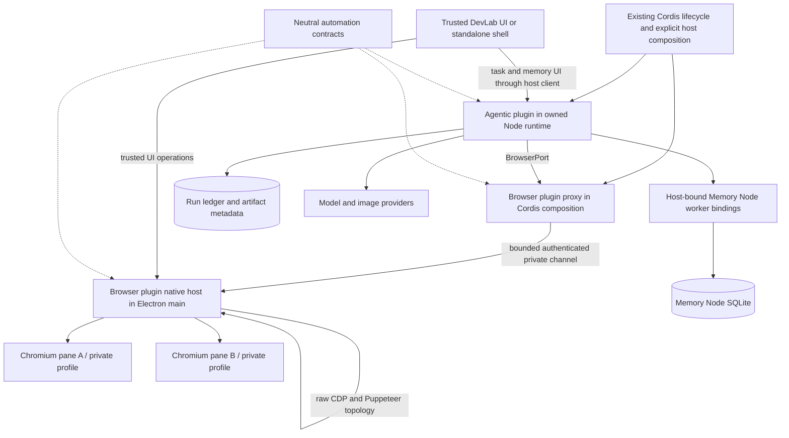
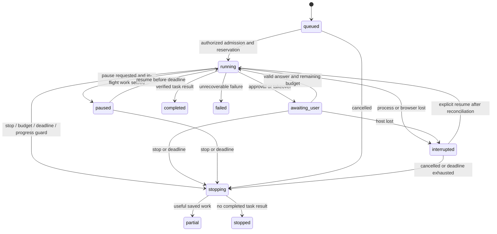

# Agentic browsing and split Chromium implementation plan

Status: **implementation in progress; AB0 feasibility verified 2026-11-16**.
Prepared 2026-11-15 for `_devLAB-refactored`; the user's subsequent implementation
request superseded the planning-only restriction. A standalone development host
now runs with Browser and Agentic through Cordis. AB1/AB2 are partial; later slices
remain planned. The live DevLab profile remains unchanged. Acceptance and actual
checks are recorded below; this is not a completed production control layer.

Build two independently reusable feature plugins: **Browser** owns Chromium,
split surfaces and deterministic browser control; **Agentic** owns independent
agent sessions, bounded workflows, vision, artifacts and the connection to the
existing Memory Node. Ship the same capabilities in DevLab and a minimal standalone
desktop host. Keep Cordis lifecycle and DevLab's retained resource owners.

Memory Node is the selected memory implementation, not a third new feature plugin.
A small contracts package and host composition are infrastructure, not additional
feature plugins. No new kernel, general integration bus or parallel memory engine
is proposed.

The native embedding direction is selected for investigation, with a blocking
compatibility spike before production work. Existing source does not establish
that Electron's debugger and Nanobrowser's Puppeteer transport are interchangeable.

## 1. Product behavior and boundaries

1. Open the standalone app or DevLab's Browser workspace and browse manually.
2. Split right or down. By default, create an independent browser context, agent
   session and persistent personal memory profile for the new pane.
3. Give each pane a separate task, model and budget. Stop or steer one without
   affecting another. Each session keeps its own conversation and work history.
4. Optionally let several role agents cooperate inside one session. They share
   that task's artifacts through typed results; they do not independently drive
   the same page or gain another session's memory.
5. Run a task for **up to** a selected duration, such as 30 minutes, subject to
   spending, turn, concurrency and progress limits. Finish earlier when useful.
6. Inspect real image artifacts, compare prompt variants, refine selected results
   and show a downloadable gallery with provenance and costs.
7. Reopen a saved session with its personal memory. Layout changes do not change
   identity, cookies, conversation, permissions or memory assignment.

“Split” means a layout operation plus an explicit session-creation choice. It
does not mean cloning credentials, granting shared memory, copying an active run
or presenting one live `webContents` in two places. Browser-only operation works
without the Agentic plugin; Agentic can operate without a browser for provider/API
workflows, with browser tools visibly unavailable.

First release: local single-owner desktop application; Linux first; Chromium
embedded through a verified native host; up to four visible panes and four active
independent agent sessions as initial configurable resource limits. Start with
two simultaneous panes in the first integration slice. Accounts, cloud workers,
scheduled unattended runs, arbitrary native desktop automation and model-weight
training are later work. “Any browser / any system” is an adapter roadmap, not an
initial support claim.

## 2. Current source and reuse decisions

Paths are relative to this document. Findings describe inspected source, not a
fresh end-to-end execution of either application.

| Component and evidence | Current behavior and coupling | Decision |
| --- | --- | --- |
| [DevLab composition](../../../src/profile.ts), [startup](../../../src/server.ts) | Eight selected backend plugins; Cordis-backed lifetime and grants; no browser runtime selected. | Retain kernel; add opt-in feature composition through public factories. |
| [Browser client composition](../../../src/main.ts), [workspace owners](../../../src/workspace.ts) | Browser and preview-inspector client capabilities are explicitly unset; retained project/canvas/preview owners survive compatible HMR. | Enable a new capability only after its backend is ready; retain owner identity across views. |
| [Browser contracts](../../../packages/contracts/src/browser.ts) | Browser/page generations, actors, leases and command IDs; existing actions address locators or coordinates. | Reuse identity/lease concepts; introduce a versioned ref-based control contract. Locator actions cannot masquerade as observed-node refs. |
| [Browser HTTP adapter](../../../plugins/transport-http/src/browser.ts), [service map](../../../packages/contracts/src/index.ts) | Optional `BrowserControl` routes and lifecycle services exist; interfaces are DevLab-specific. | Add a versioned adapter; keep service-map types dependent on neutral contracts rather than plugin internals. |
| `vendor/previous-ui/devlab-browser-harness-0.1.0.tgz`, source `src/index.ts` | Fenced ownership, generation checks and command-ID admission; state is in memory. | Adapt the bounded ownership rules; add durable uncertainty handling. Do not claim exactly-once effects from a set of seen IDs. |
| `vendor/previous-ui/devlab-browser-chromium-0.1.0.tgz`, source `src/playwright.ts` | Launches a persistent Chromium context and executes Playwright locators; this is not native split embedding. | Reference lifecycle/profile handling; do not reactivate as the ref-based agent control implementation. |
| [Nanobrowser controller ports](../../../../NANO/nanobrowser/src/browser-control/core/ports.ts), [controller](../../../../NANO/nanobrowser/src/browser-control/core/controller.ts) | Core receives CDP, frame, page, tab, epoch and user-prompt interfaces. Chrome implementations are separate. | Adapt a pinned, attributed copy inside Browser after the native-host spike; leave the upstream checkout unchanged. |
| [Puppeteer connection](../../../../NANO/nanobrowser/src/browser-control/host/puppeteer.ts) | Uses `ExtensionTransport.connectTab` and internal Puppeteer imports through Chrome extension APIs. | New Electron transport required; no assumption that plain `connect()` against a page-level debugger works. Pin the tested combination. |
| [Refs](../../../../NANO/nanobrowser/src/browser-control/core/refs.ts), [receipts](../../../../NANO/nanobrowser/src/browser-control/protocol/results.ts) | Refs are bound to seen nodes/documents; dispatch, effect and postcondition are separate. | Preserve these semantics and fixture coverage. Refs are never reusable memory. |
| [Agent loop](../../../../NANO/nanobrowser/src/agent/loop.ts), [guards](../../../../NANO/nanobrowser/src/agent/guards.ts), [restore](../../../../NANO/nanobrowser/src/agent/restore.ts) | Tool loop, vision, guards, context management and interrupted-action reconciliation; tied to IndexedDB, extension protocol and one conversation loop. | Adapt algorithms behind Agentic ports; replace extension/store wiring. Do not describe the whole loop as a portable package already. |
| [Provider interface](../../../../NANO/nanobrowser/src/llm/index.ts), [settings](../../../../NANO/nanobrowser/src/store/settings.ts) | Multiple providers, image capability and custom instructions; model capability learning is narrower than workflow learning. | Reuse reviewed provider behavior where compatible; add an explicit image-generation/editing port. |
| [Extracted runtime](../../../../devLAB-planning-runtime-standalone/README.md), `source/src/runtime/engine.ts` | Preserved serial plan/build/check/repair workflow, timers and records; not an independently installed runtime. | Reference bounded repair and reconciliation; do not revive the old factory or create a second scheduler. |
| [Memory Node core](../../../../_ai-engineering/memory/memory-node/memory_node/memory.py), [models](../../../../_ai-engineering/memory/memory-node/memory_node/models.py), [tools](../../../../_ai-engineering/memory/memory-node/memory_node/adapters/tools.py) | Python/SQLite governed memory, explicit Access, four durable kinds, CAS, idempotency, review and erasure. | Reuse public `Memory`, `Access`, `AgentTools` and context composition. No TypeScript rewrite or private SQL access. |
| [Memory Node API](../../../../_ai-engineering/memory/memory-node/docs/API.md), [architecture](../../../../_ai-engineering/memory/memory-node/docs/ARCHITECTURE.md) | Lexical FTS5; bounded character-counted XML; default HTTP/CLI identity has fixed local scopes. | Host-bound worker with immutable grants per binding. Do not forward one default token to all sessions or claim vector retrieval. |

The existing [integration plan](../herdr-wisdohm-memory.md) owns Herdr, WISDOHM and
compact-workspace work. This document owns browsing and agent execution. Its
memory slices consume the same Memory Node integration; they must not establish
a competing store, promotion pipeline or task tracker.

## 3. Architecture decision

| Option | Strength | Main limitation | Decision |
| --- | --- | --- | --- |
| Extend the existing extension | Closest reuse of current Chrome/Edge browser control. | Does not provide the requested embedded split browser; external orchestration is outside its current contract. | Future adapter, not initial product host. |
| Node runtime plus separate Chromium with streamed frames | Uses familiar process/profile ownership and can run without a desktop shell. | A remote image surface differs in input, accessibility and rendering from native embedded pages. | Explicit future presentation adapter; no silent fallback. |
| Electron Chromium surfaces plus separate Agentic runtime | Native split page surfaces, standalone packaging and a DevLab integration path. | Native-view layout, debugger transport compatibility, runtime packaging and remote-page security require proof. | Selected direction, contingent on AB0. |

Electron documents multiple `WebContentsView` instances with independent bounds;
one `webContents` can belong to only one such view. Use that native composition
rather than an iframe of the target site. This establishes an embedding API, not
compatibility with Nanobrowser. [WebContentsView documentation](https://www.electronjs.org/docs/latest/api/web-contents-view)

### Runtime topology



The diagram describes the proposed topology. Browser's proxy and native component
are two process halves of one feature plugin, not additional plugins. The desktop
host owns process startup and the window; Browser owns page resources and control.
Agentic owns runs. Memory Node owns memory behavior and its SQLite schema.

**DevLab deployment:** its current backend registers Browser's proxy and Agentic
through Cordis. A verified desktop-host capability provides the native Browser
component. The ordinary HTTP frontend cannot acquire Electron privileges simply
by enabling a client flag. Until native-host readiness is established, render an
unavailable state and retain the normal workspace.

**Standalone deployment:** a small desktop composition starts the same two
features and a minimal UI without importing DevLab's editor, terminals, Herdr,
WISDOHM, source registry or historical executors. Reuse the kernel lifecycle with
only the required composition. Bundle or explicitly provision the supported Node
and Python runtimes; require no absolute development-checkout paths.

Use a private inherited pipe/stdio channel between the owned Node process and
Electron main, with startup authentication, protocol versions, bounded messages,
correlation IDs, cancellation and disconnect semantics. No public debugging port,
generic raw-CDP endpoint or arbitrary shell execution is part of the product API.
DevLab's host transport must also bind UI requests to a trusted local principal;
an origin check alone is not an identity or grant.

## 4. Exactly two feature plugins and public seams

| Unit | Owns | Must not own |
| --- | --- | --- |
| Browser plugin | Chromium surfaces/profiles, layout binding, page/tab lifetime, Puppeteer frame topology, deterministic observation/actions, receipts, permission dispatch gate, browser leases and native-host bridge. | Models, task decomposition, semantic memory, prompt experimentation or runtime-wide scheduling. |
| Agentic plugin | Independent sessions, coordinator/worker execution, provider access, vision evaluation, bounded scheduling, run ledger, artifacts and Memory Node binding/UI facade. | Raw CDP, native window objects, page/frame registries or Memory Node SQL/promotion logic. |
| Neutral contracts package | Versioned DTOs, schemas, result/errors, narrow BrowserPort/AgenticService/Memory facade contracts. | Runtime services, Electron/Chrome/Node objects, secrets, scheduler or third feature plugin. |
| DevLab and standalone composition | Select feature factories, trusted identity/configuration, lifecycle, host transport and storage roots. | Duplicated feature implementations or model-selected grants. |

Proposed layout, not files created by this planning task:

```text
packages/automation-contracts/src/
  browser.ts       # BrowserPort v2, observed targets, receipts, leases
  agentic.ts       # sessions, task budgets, role messages, run events
  memory.ts        # host-facing memory references and bounded results
plugins/browser/src/
  index.ts         # independent factory and disposal API
  native/          # Electron surfaces, partition/profile ownership, debugger
  control/         # attributed deterministic Nanobrowser adaptation
  bridge/          # private protocol and Node proxy
  ui/              # split workspace presentation; no page control authority
  devlab.ts        # thin Cordis factory, using only public host interfaces
plugins/agentic/src/
  index.ts         # independent factory and disposal API
  sessions/        # identity, admission, run lifecycle and budgets
  agents/          # loop, context, roles and completion evidence
  providers/       # text/vision and generation/editing adapters
  memory/          # Node broker and small host-bound Python worker
  records/         # run/checkpoint ledger and artifact registry
  workflows/      # logo exploration definition and evaluators
  ui/              # task controls, activity, gallery and memory inspection
  devlab.ts        # thin Cordis factory
apps/automation-desktop/
  main.ts          # window and owned process composition
  preload.ts       # narrow bridge for trusted shell only
  renderer/        # minimal standalone workspace
```

Start cohesive modules; create private files only when their first caller needs
them. The tree names responsibility boundaries, not a requirement to create an
empty framework in advance. Product namespace/package names are provisional.

Runtime imports: both plugins depend on neutral contracts. Browser never imports
Agentic. Agentic receives a BrowserPort, with no dependency on Browser internals.
DevLab's service map imports neutral types, avoiding a contracts↔plugin cycle.
Only `/devlab` entrypoints depend on DevLab's plugin contracts. Only Browser's
native subpath imports Electron. Browser UI bundles cannot import that subpath.

Proposed Cordis service keys: Browser provides `browsingV2`; Agentic provides
`agentic` and a `memory` facade for existing rules/UI consumers. These are services
from two plugins, not three plugins. The memory facade works without starting a
task. A browser-enabled composition declares Agentic's `browsingV2` requirement;
API-only composition omits browser tools and that requirement. No activation
automatically launches an agent run.

Current `browsers`/`browserControl` remain disabled until explicit migration of
their consumers. Preserve saved Browser node payloads and give incompatible ones
a clear migration state. Do not reinterpret a legacy locator as a v2 ref.

## 5. Session identity, splits and personal memory

| Identity | Meaning and lifetime |
| --- | --- |
| Owner/project | Trusted host authorization boundary; neither comes from model-selected grants. |
| Workspace/layout ID | Split tree and presentation preferences. Reordering changes only layout. |
| Pane ID | A visible slot; a session can move between slots. |
| Browser context ID | Cookie/cache/profile boundary; private by default. |
| Browser generation/page ID | Current runtime target; generation changes on recreation/crash. |
| Agent session ID | Durable conversation/task workspace; survives pane moves and multiple runs. |
| Run ID | One bounded execution attempt with its own deadline and usage ledger. |
| Memory profile ID | Durable personal memory selection; new independent session gets a new one. |
| Role worker ID | A bounded child execution belonging to one parent run; no independent authority. |

Default Split creates a blank page in a fresh Chromium partition, a fresh agent
session and a fresh memory profile. It does not copy cookies or transcript. Offer
separate labelled commands for a new tab in the same session/profile, and for
starting a new conversation with an explicitly selected existing memory profile.
Sharing login state and sharing personal memory are separate choices. Reusing a
memory profile means intentional sharing, visible in both sessions.

Use a split tree of leaf pane IDs and horizontal/vertical branches with bounded
ratios. Default is two columns; support nested splits to four visible leaves.
Layout serialization contains IDs and ratios, never cookies, tokens or page refs.
Collapse/move/maximize retains the resource; a single presentation owns native
bounds and human focus. A narrow viewport switches between retained panes instead
of shrinking every page below its usable size. Initial total retained-page limit:
eight, with explicit resource-limit results rather than silent eviction.

Native content must not cover app approvals or inspectors. Host layout coordinates
must account for zoom, device scale, clipping, scrolling and window resize; an
open modal hides/detaches the appropriate native presentation without destroying
the page. Test focus restoration and OS hit testing. A screenshot grid is not
acceptance for native interactive split browsing.

Electron partitions can be persistent or in-memory and reuse a session when their
partition string matches. The host generates these strings from trusted IDs, with
no default/shared partition for independent sessions. This provides browser
storage separation, not an operating-system security boundary.
[Electron session documentation](https://www.electronjs.org/docs/latest/api/session)

### Memory Node binding

One host-selected Memory Node database contains isolated namespaces. Preserve the
standalone Memory Node application's existing `.memory/` and `.runtime/`; do not
point development tests or a new product at those live files. DevLab's configured
memory root and standalone app data use the same adapter implementation, not
uncoordinated copies of memory code.

These are application-level access boundaries. Processes with the same operating
system user's filesystem access can still read that user's files; private scopes
do not provide isolation against a hostile local process with equivalent rights.

For each binding, derive a stable namespace such as `ab:<sha256(binding)>` from
installation, owner, project and memory-profile IDs. Hashing keeps the identifier
within Memory Node's current 120-character limit. Actor `session:<session-id>` is
stable across worker restarts so idempotent retries keep the same actor. Default
read/write grants are exactly `agent:<memory-profile-id>` and
`session:<agent-session-id>`. No user, team, global or other project grants are
implicitly added. An existing profile may be selected only by its authorized owner.

| Information | Authority/storage |
| --- | --- |
| Personal facts, preferences, episodes and accepted procedures | Memory Node, within the bound personal namespace/scopes. |
| Current conversation summary and role context | Agentic working state; bounded when sent to a model. |
| Run status, budgets, command intent/results, recovery and artifact metadata | Agentic run ledger, not semantic memory. |
| Browser login/cache | Browser's isolated profile; never ordinary memory. |
| Modes, tool grants, identity, model keys, memory Access and file roots | Trusted host configuration/secret storage. |
| Images, exports and detailed experiment records | Artifact store and run ledger; memory may contain opaque provenance references. |

Implement one small owned Python worker adapter inside Agentic. It imports the
installed/pinned public `Memory`, `Access` and `AgentTools` interfaces. At startup,
the trusted host supplies an immutable binding over an inherited private channel;
model-facing operations cannot replace that binding. A worker is keyed by the
binding digest and may serve multiple runs of that same session, never another
principal. Bound the active pool and reap idle workers without deleting memory.

Use JSON messages with validated operation names, correlation IDs, a 64 KiB input
ceiling, bounded result sizes, a proposed 10-second memory-operation timeout and
cancellation semantics. SQLite's current busy wait is up to five seconds; a lost
worker response is uncertain delivery, not proof of failure. Mutation retries
reuse both request ID and input. Workers do not execute project-provided Python,
modify `sys.path` from tool arguments or select DB paths from requests.

Owner inspection/review uses a separate host-bound access path. Agent operations
remain remember/recall/forget/compact/context. The broker rejects candidate scopes
outside its binding, generates durable request IDs before dispatch and applies CAS
for replacement. A project/session argument may narrow a grant; it cannot widen it.
Do not invoke the existing CLI as a substitute: it currently uses `local_access`.

Memory Node itself requires review for some shared procedures, but not every
private procedural write. Agentic must therefore hold experimental lessons in its
run ledger until evaluation passes; only its trusted promotion path writes an
accepted procedural memory. Child agents return candidates to the coordinator.
No autonomous child receives owner review authority.

First release keeps sessions private. Cross-profile/team sharing, semantic search,
automatic TTL/confidence scoring and cross-namespace copy/erasure lineage need
separate designs. These are not existing Candidate fields. Use present timestamps,
versions, source attribution and explicit records rather than inventing schema
support. Forgetting memory must also offer removal of linked transcript/export
copies; Memory Node's erasure cannot remove content stored by Agentic or backups.

Context remains escaped, character-budgeted, untrusted evidence. Include IDs,
omissions and snapshot. Count the combined task, memory, page, image and role
context against the selected model's token window; character budgets are not
token guarantees. Recheck namespace/access on every call, including restore.

## 6. Browser identity, ownership and dispatch

Browser owns one serialization point per browser context for mutations. At most
one human or agent writer holds its fenced lease. A session may own several pages
inside that context, but unrelated sessions do not share its writer. Role workers
request actions through their coordinator, never directly through a raw tool port.

Human takeover revokes the lease and increments its fence. Stop, generation
change, closed page and expired authorization also revoke it. Recheck the fence
immediately before dispatch, after waits/approvals, and when responses return.
The low-level Browser layer additionally serializes actions on each target.

Preserve these Nanobrowser invariants in the new adaptation:

- Act on the browser node identity the session was shown; stale or unknown refs
  fail closed. Navigation, detach and generation changes invalidate refs.
- Puppeteer remains the frame/session topology authority, including OOPIFs. The
  transport may route protocol messages; it must not become a competing frame tree.
- Find no elements through Puppeteer selectors. Dispatch raw CDP to the frame
  session Puppeteer reports. Keep observation read-only and expose partial capture.
- Choose and name an interaction mechanism before dispatch. Never silently switch
  nodes, selectors or pointer mechanisms after a failure.
- Report dispatch, page effect and expected-state verification separately.
- Bound every call and wait. No automatic resend after an input event is sent;
  unknown delivery requires observation/reconciliation before a new action.
- Keep model-authored page scripts and raw devtools unavailable to agents.

Electron exposes debugger events and commands with optional CDP session IDs.
Puppeteer accepts a custom ConnectionTransport. These interfaces make an adapter
plausible but do not prove its browser-target negotiation, OOPIF handling or version
compatibility; AB0 must establish those properties.
[Electron Debugger](https://www.electronjs.org/docs/latest/api/debugger),
[Puppeteer ConnectOptions](https://pptr.dev/api/puppeteer.connectoptions),
[ConnectionTransport](https://pptr.dev/api/puppeteer.connectiontransport)

Keep the existing Nanobrowser checkout's extension-only design intact. The new
application's attributed adaptation has its own Electron host contract. Do not
retrofit WebSocket CDP, browser launching or an external daemon into upstream
`src/browser-control/` to make this product fit.

## 7. Agent roles, concurrency and visual intelligence

One scheduler owns all runs in an installation. Independent sessions have separate
conversation/context, memory binding, permission revision, browser context and
budget. Role agents have distinct execution IDs and bounded contexts. A pipeline
stage implemented as a pure function is labelled a stage, not a second agent.

| Role | Input/result | Authority |
| --- | --- | --- |
| Coordinator | User task, budgets, evaluated results → next assignments/final result. | Allocates child work and browser writer; only accepted memory promotion path. |
| Prompt explorer | Brief and observed results → diverse prompt candidates with hypotheses. | No browser mutation or direct memory write. |
| Generator/operator | Approved candidate and provider/browser job → actual artifact/job receipt. | Scoped generation API; serialized browser actions when assigned. |
| Visual critic | Actual image bytes and rubric → structured evidence, scores and uncertainty. | Vision model/read-only artifact access; no writes to pages. |
| Curator | Valid artifacts and evaluated comparisons → shortlist and export manifest. | Artifact references and bounded file output. |

Begin with one coordinator and at most two role workers per session; global
in-flight model limit four and generation-job limit two. These are initial product
limits to measure, not throughput claims. Apply queue backpressure, fair scheduling
between sessions, starvation prevention and reservation of remaining budgets before
fan-out. Worker retries do not reset the parent's guard counters or allowance.

Record baseline and incremental RAM/CPU for each pane, active role worker and
memory binding, plus model queue delay and browser-operation latency. Raise limits
only against those measurements. Distributed execution would require a separate
lease/authority and durable coordination design; adding workers to the current
local SQLite deployment is not a proven horizontal-scaling strategy.

Typed assignments include parent run/task IDs, role, objective, input artifact
versions, expected result schema, read/write capabilities, deadline and reservation
ID. Results include status, artifacts, observations, cost/usage, uncertainty and
unresolved obligations. Reject late results for obsolete assignments; account for
their actual costs even if discarded. Cap worker depth at one in the first release.

Compare multiagent output with a single-agent baseline on the same brief set and
budget: useful candidates, user preference, duplicate rate, time and cost. Keep
extra agents only where that evaluation supports their value. Disagreement goes
to the coordinator or user; no role may unilaterally expand task scope.

Vision has three distinct inputs: a current browser screenshot, generated image
bytes, and an optional user reference. An image-capable chat model is not an image
generator. Generation/editing is a separate provider interface. Readiness must show
which capabilities each selected provider actually supports.

## 8. Bounded loop, state machine and deadlines

Default duration is maximum wall-clock time from run admission, including model
latency, provider queues, user approval, pauses, sleep and downtime. A 30-minute
run reserves its final two minutes for cancellation, persistence, selection and
summary. If approval consumes the remaining allowance, preserve work and stop.
The UI explains this meaning before Start.

Pausing preserves remaining allowance rather than extending the absolute deadline.
Resume checks the original deadline. The user can explicitly start a new run with
a new budget; neither an agent nor recovery can silently do so. Clock movement
and host sleep are tested: use a monotonic clock while alive and a persisted UTC
deadline across restarts, with suspicious clock changes causing reconciliation.



```text
admit task with host-bound session, permissions and immutable budget
persist run + deadline + generation + initial budget reservations
while run is eligible:
  process steering, stop and expired reservations
  check deadline, cost, turns, tool count and progress guards
  if exploration cutoff reached: enter bounded finalization
  retrieve bounded authorized memory and current page/artifact evidence
  assign one step or a bounded set of independent role jobs
  before every model/tool dispatch:
    recheck admission, deadline, authority and reservation
    persist intent and stable operation ID
  observe results; distinguish dispatched / reacted / verified
  persist result, usage and unresolved verification obligations
  evaluate progress and choose continue / refine / finish / handover
on interruption: retain uncertain operations and revoke old browser leases
on stop/deadline: abort local work, cancel supported remote jobs, save job IDs
finalize within the reserved time; use a deterministic summary if no model fits
```

Each run also has hard caps for turns, tool calls, artifact bytes, workers, tokens
and recoveries. Charge all children to the same parent allowance. Initial guards:
repetition-window detection, three consecutive no-effect mutations, five sequential
tool errors, at most two automatic recovery attempts for one failure category.
Validate thresholds against fixtures rather than treating these defaults as
universal. Budget exhaustion is a distinct outcome, not a successful completion.

Strict spending mode admits only operations with an available price/reservation
policy; unknown-priced operations require user allocation. Reserve the maximum
allowed call/job cost before dispatch, reconcile actual usage and retain unknown
usage separately. Local admission cannot guarantee an external provider's final
bill when metering/cancellation is delayed; expose that uncertainty and use
provider-enforced limits where available. No paid evaluation is run by this plan.

## 9. Durable execution, retries and lifecycle

The run ledger stores session/run IDs, immutable task input, policy revision,
deadlines, role assignments, reservations, command intent, delivery/result state,
provider job IDs, artifact manifests, checkpoint context and completion evidence.
It is authoritative for execution; Memory Node is authoritative for semantic
memory. Do not use FTS recall or model summaries to reconstruct a dispatch log.

Use a private run-store module. Evaluate the existing archived SQLite worker
pattern (`devlab-store-sqlite-0.1.0.tgz`) and the selected Node runtime's built-in
SQLite support before writing a replacement. Do not import the retired general
store/executor or reuse its live database. Run storage and memory storage may use
different SQLite files because they own different facts; only Python opens the
Memory Node file.

Persist intent before starting a mutation and result after it. A crash between
them yields `delivery=unknown`, not permission to replay. Browser and provider
idempotency keys are used where genuinely supported; command-ID deduplication
alone cannot guarantee exactly-once browser effects. Memory retries preserve
namespace, actor, request ID and payload so the core's receipt is authoritative.

Recreation increments browser generation and lease fence. Persisted checkpoints
may retain URLs and descriptions, never usable refs or live CDP sessions. Resume
reobserves and reconciles external state, verifies permissions and remaining
budget, and requires an explicit user action by default. Restore does not
automatically call a model, submit a form or restart a generation job.

Hide/collapse detaches presentation while sessions continue inside their budget.
Closing one pane offers move/detach or stop-and-close; it never deletes personal
memory. Closing the standalone application checkpoints runs, revokes dispatch and
closes its owned resources. Background-on-close is later explicit behavior.
DevLab panel unmount/reload does not own backend task or Chromium destruction.

On shutdown, stop Agentic admission, cancel/checkpoint runs, release writers and
dispose memory workers before Browser closes native resources. Repeated disposal
is safe. An exclusive runtime-root ownership lock prevents two schedulers owning
the same sessions. Memory Node's normal concurrent scoped connections remain
governed by its transaction rules.

Native content needs explicit teardown: Electron's BaseWindow does not
automatically destroy child views' `webContents`. Track owned resources and close
them deliberately; do not infer cleanup from closing a window.
[BaseWindow resource management](https://www.electronjs.org/docs/latest/api/base-window)

## 10. Representative public contracts

Design examples only; translate to versioned schemas during AB0. The UI supplies
session choices and task content; the host binds principal, grants and file roots.
Opaque handles are authorization-checked, never trusted because their UUID exists.

```ts
interface BrowserTargetV2 {
  contextId: string;
  generation: string;
  pageId: string;
}
interface ObservedNodeV2 {
  ref: string;
  observationId: string;
  documentEpoch: string;
}
interface BrowserCommandV2 {
  operationId: string;
  target: BrowserTargetV2;
  lease: { id: string; fence: number };
  tool: string; // validated against the versioned catalogue
  args: Record<string, unknown>; // schema validated; mutations use observed refs
}
interface BrowserPort {
  capabilities(): Promise<{ apiVersion: 2; nativeSplits: boolean; vision: boolean }>;
  observe(target: BrowserTargetV2, signal: AbortSignal): Promise<ObservationV2>;
  execute(command: BrowserCommandV2, signal: AbortSignal): Promise<BrowserResultV2>;
  acquire(target: BrowserTargetV2, signal: AbortSignal): Promise<WriterLeaseV2>;
  release(leaseId: string): Promise<void>;
}
interface SessionBinding {
  sessionId: string;
  ownerId: string;
  projectId: string;
  memoryProfileId: string;
  browserContextId?: string;
  permissionRevision: string;
}
interface RunBudget {
  durationMs: number;
  finalizationReserveMs: number;
  maxTurns: number;
  maxToolCalls: number;
  maxConcurrentChildren: number;
  maxTokens: number;
  spending?: { currency: string; maximumMinorUnits: number };
}
interface AgenticService {
  createSession(input: NewSessionInput): Promise<SessionView>;
  start(input: { sessionId: string; task: string; budget: RunBudget }): Promise<RunView>;
  steer(runId: string, message: string): Promise<void>;
  pause(runId: string): Promise<RunView>;
  stop(runId: string): Promise<RunView>;
  resume(runId: string): Promise<RunView>;
  events(runId: string, afterSequence: number): AsyncIterable<RunEvent>;
}
```

`ObservationV2` states completeness, truncation and observed-node validity.
`BrowserResultV2` preserves separate dispatch/effect/postcondition outcomes,
typed errors and pending handovers. Correlation IDs are distinct from idempotency
IDs. Version handshakes reject unsupported peers before accepting work. Sequence
replay is bounded; an expired cursor returns a snapshot plus an explicit gap.
The factory that exposes these interfaces is already bound to a trusted host
principal; model calls cannot construct a different SessionBinding.

Memory's agent-facing schema remains the existing five-operation contract.
The host's Memory facade exposes records/history/review only on the owner's
authenticated route. It never returns filesystem DB paths, tokens or Access objects.

## 11. Logo exploration as the first creative workflow

Example configuration, not a current executable format:

```yaml
workflow: logo-exploration.v1
task: Explore logo directions for the user's supplied brand brief
session: selected-by-host
memory: private-session-profile
budget:
  durationMs: 1800000
  finalizationReserveMs: 120000
  maxTurns: 60
  maxToolCalls: 240
  maxConcurrentChildren: 2
  maxTokens: 120000
  spending: supplied-by-user-or-host-profile
generation:
  provider: selected-installed-capability
  route: api-or-user-selected-browser-workflow
  maximumJobs: 12
evaluation:
  rubric: [brief_adherence, legibility, composition, small_size, diversity, file_validity]
  shortlistMaximum: 4
```

Execution example:

1. Session A recalls only its authorized brand preferences, combines the current
   user brief, lists missing creative constraints and confirms the configured
   generation route is ready. Missing account/secret entry is a user step.
2. The prompt explorer proposes three distinct directions and records each
   hypothesis. The coordinator reserves generation budget and assigns jobs.
3. The operator uses the selected API or the session's page refs, subject to write
   policy. Store provider job IDs before polling; obey provider/site rate limits.
4. Save actual returned files, MIME/size/hash and provider metadata before critique.
   A download-started browser event is not proof that the file exists and is valid.
5. The critic sees image bytes and compares them with the brief; it returns
   evidence and uncertainty with scores. It cannot establish trademark clearance.
6. Refine promising directions if measured gain, time and spending justify another
   iteration. Deduplicate exact files by hash; visual similarity can inform
   diversity but cannot by itself prove originality or copyright status.
7. Before the exploration cutoff, select up to four candidates. Save files,
   prompt/settings/lineage, evaluation and costs in a manifest. Preserve rejected
   candidates according to the user's retention setting.
8. Ask for feedback on the gallery. Store a preference or evaluated lesson only
   through the governed promotion path. A pending lesson is not a trusted skill.

Session B may independently explore another brand at the same time. Stop A must
leave B's browser, memory, reservations and output intact. The scheduler still
applies installation-wide resource/spending limits.

Raster generation, editing and vector generation are different capabilities.
Export PNG/WebP/JPEG only when actual valid files exist. Export SVG only when a
provider or explicit vector workflow produced validated SVG; sanitize previews
and remove active content. Never rename a bitmap or screenshot to `.svg`.

## 12. Learning, recovery and permissions

**Learning** means evaluated memory/procedure adaptation. Each experiment records
brief, prompt version, provider/model version, settings, actual artifact, rubric,
usage and user feedback. Candidate lessons remain excluded from active procedures
until tested against baseline and held-out briefs. Promotion records the evidence
references and version; rollback restores the prior accepted procedure. A provider
or site change can invalidate a procedure. No model-weight training is implied.

**Healing** means typed, bounded recovery. Reobserve stale refs, handle provider
rate limits before dispatch, reconnect a lost read channel, reconcile an uncertain
job ID, and stop after repeated no-progress. Login, payment, permissions, ambiguous
delivery and unsupported protocol versions have explicit user/blocking outcomes.
Source-code repair is later separate work with isolated changes, tests and rollback;
an operational agent does not patch its own dispatch or authorization code.

Preserve host-controlled permission semantics: reading/moving proceed; detected
writes obey Ask/Auto and per-site rules; payment, access grants, secret input and
page prompt dialogs are user steps in all modes. An agent cannot change these
policies. Role assignment and memory promotion never confer authority. A paid image
API call also consumes its explicit host/user spending allocation.

For remote page views, disable Node integration, enable sandbox/context isolation,
expose no application preload, and mediate navigation, popups, downloads and device
permissions. Validate the sender/frame on trusted-shell IPC. Keep model keys and
memory credentials in privileged processes. These settings are part of the native
host acceptance, not a claim of full browser hardening.
[Electron security guidance](https://www.electronjs.org/docs/latest/tutorial/security)

Keep untrusted boundaries around page text, attachments, images and memory. Mask
password, payment-card and one-time-code content in observations/logs. Host-issued
file IDs authorize uploads/download destinations; a model cannot name arbitrary
paths. Test redirects and private/local-resource navigation under a clear URL policy.

## 13. Delivery slices and dependencies

Statuses reflect the implementation evidence below. Slices cross backend/UI boundaries where that proves user behavior;
each source edit still follows one owner's bounded preflight.

| Slice | Depends on | Demo and acceptance |
| --- | --- | --- |
| AB0: native host and contract feasibility — **done** | Installed components reused; no dependency added | Disposable two-view host; exact Electron/Chromium/Puppeteer/Node/Python versions recorded; observed-node action through Electron debugger, OOPIF navigation, screenshot, stop and detach verified. Private IPC and fixed Memory Node binding round-trip pass. Failure produces a revised architecture decision, not a selector fallback. |
| AB1: standalone manual split browser — **in progress** | AB0 | Same Browser plugin creates two interactive native panes; private cookies/storage; split right/down, move, resize, collapse/maximize and close work; popup/download policy and cleanup verified. Browser runs without Agentic. Remaining: full native OS hit/focus/keyboard and download/device/redirect coverage on composed nonblank pages. |
| AB2: independent sessions and personal memory — **in progress** | AB1; existing M0–M2 behavior from parent plan implemented through the shared binding | Start two sessions with distinct private profiles; remember/recall/update/review/forget/context through Memory Node; reopen preserves identity. Session A cannot read B, including guessed record IDs and forged scopes. Fake provider task state appears beside each pane. Remaining: M0–M2 review/history/compaction and DevLab UI acceptance. |
| AB3: first complete DevLab + standalone browsing slice | AB2 | One real model adapter plus deterministic fake provider; per-pane agent observes and acts on fixtures, uses vision where supported and records verification debt. Both hosts run the same feature factories. Two tasks work independently; Stop A leaves B and all editor/terminal/preview drafts intact. |
| AB4: bounded durable runs | AB3 | Thirty-minute maximum, cost/turn/tool limits, steering, pause, deadline, fairness and partial exports work. Crash at each intent/result boundary creates truthful uncertainty; explicit Resume reobserves and never repeats an unknown mutation automatically. Accelerated clock tests plus one real-duration disposable soak. |
| AB5: multiagent logo exploration | AB4 | Genuine bounded prompt-explorer/operator/critic executions, generation/editing adapter, actual artifact validation, scoring/refinement and gallery. Shortlist and costs survive Stop. Compare with single-agent baseline under equal budget. |
| AB6: evaluated learning and bounded healing | AB5 | Held-out evaluation gates procedure promotion; rollback and stale-procedure invalidation pass. Typed recovery limits, circuit breakers and interrupted provider-job reconciliation preserve budgets and user control. |
| AB7: distribution and additional platforms | AB3–AB6 relevant release scope | Standalone installer and DevLab integration declare the same contract versions; approved branding/notices, fresh-data install, offline/missing-runtime states, safe update/rollback and data preservation verified. Windows/macOS are separate acceptance tracks, not inherited Linux claims. |

AB2 and parent M0–M2 are **one implementation**, with the memory backend/facade
inside Agentic. Parent memory UI and rules consumers call that facade. This resolves
the earlier proposal for a separate memory plugin without duplicating its status:
memory acceptance remains in M0–M2; AB2 owns per-browser-session mapping and tests.
Herdr and WISDOHM integration are not prerequisites for standalone browsing.

### AB0 source-change scope

Implementation rechecked source and CODE/VERIFICATION before editing. Existing
Electron/Puppeteer installations were reused via explicit host inputs. Approval
is still required before adding a standalone dependency manifest/lockfile or
changing build policy. No Electron/Puppeteer/AI SDK dependency was installed.

Canonical owners now include `browser-plugin`, `agentic-plugin`,
`automation-contracts` and the separate `automation-desktop` composition owner.
Verification owns the new tests; planning-protocol owns these plan/memory updates.
Existing terminal scopes were not rewritten. The compatibility projection is
generated through `ownership:sync`.

The implementation used `.mjs` for native/Node modules so installed runtimes can
execute the spike without a new build configuration. Actual writes include:

- `packages/automation-contracts/src/browser.ts` and its narrow public exports;
  package metadata only through the dependency/configuration approval path.
- `plugins/browser/src/native/debugger-transport.mjs`, a public factory and a
  disposable native-host fixture under its test scope.
- `plugins/agentic/src/memory/worker.py` and a host-side fixture exercising immutable
  Access with temporary DBs; no live Memory Node source/schema modification.
- Focused `.test.mjs` fixtures for native control, memory binding, session
  lifecycle, private channel, source boundaries and standalone launches.
- Canonical owner definitions for these exact writes, followed by the existing
  ownership projection command. No edits to generated output by hand.

The first demo must load same-origin and cross-origin fixture frames, observe a
button's ref, dispatch once to that node, verify the expected visible state,
navigate, reject the stale ref, and reject a command after lease revocation. A
second native pane remains independently usable. Force debugger detach and destroy
the owned window; no related listener, page or worker may remain live.

The memory fixture binds A and B in host code, writes to A with a stable request
ID, retries after a deliberately lost response, confirms one revision, rejects
B's access and confirms a forgotten item cannot be resurrected by replay. No
model or paid provider is needed for AB0.

If Puppeteer cannot maintain correct OOPIF/session topology through the Electron
transport, AB0 fails. Revisit native host/control choice explicitly. Do not build
a parallel frame registry or silently replace the promised guarantees with
Playwright locators or screenshot coordinates.

## 14. UI and retained owner integration

Browser contributes the split surface and one compact context row: pane/session,
address, navigation, split and current control owner. Agentic contributes a
collapsible task drawer with task/budget, activity, approvals, gallery and memory
inspection. Put secondary controls in existing menus/drawers. Avoid repeated
toolbars consuming page space.

Each pane displays its agent session and personal-memory label, active run status,
remaining time/budget and takeover/Stop control. The drawer follows selected pane
without switching or recreating its run. Keyboard navigation, focus restoration,
accessible split separators and visible disconnected/partial states are required.

DevLab composition changes later touch `src/profile.ts`, `src/contributions.ts`,
`src/main.ts`, `src/workspace.ts`, public contracts/client and the relevant
transport/UI owners. Preserve existing canvas node schemas with explicit version
migration. The native surface owner is retained outside ephemeral React mounts;
React supplies presentation intent, not process lifetime.

Update disconnection tests intentionally for the new selected feature profile;
retain tests proving an unselected/minimal DevLab starts without any agent or
memory runtime. Do not remove legacy-runtime absence checks just to register new
feature names. Test repeated registration, disabled capability and disposal.

## 15. Verification and rollout

| Boundary | Required evidence |
| --- | --- |
| Deterministic control | Recorded CDP payload unit cases plus native-browser fixtures: exact seen node, stale ref, OOPIF, navigation, masking, partial observation, no resend, dispatch/effect/postcondition distinction. |
| Multi-session ownership | Competing writers, lease expiration/fence revocation, takeover during approval, late child result, stop-one-continue-other and duplicate command submission. |
| Memory | Immutable bindings, cross-profile/project denial, record-ID guessing, retries/CAS, worker crash, busy DB, review separation, hostile XML, compaction/erasure lineage and context omissions. |
| Run scheduler | Fake-clock deadline/sleep/clock-change, child budget reservations, provider rate limits, no-progress guards, cancellation, unresolved usage and finalization cutoff. |
| Recovery | Kill before intent, after intent, after actual dispatch, before result persist and during memory commit; no fabricated receipt or automatic replay of ambiguous effects. |
| Native UI | Real interactive panes at 1440/820/390, scale 1/2, focus/hit testing, scrolling/clipping, overlay approvals, keyboard split/resize, hide/reopen and resource cleanup. |
| Artifacts and models | Corrupt/missing image, invalid SVG, mismatched MIME, duplicate content, generation timeout/job recovery, vision unsupported and real file export. |
| Host boundaries | Untrusted renderer IPC, forged IDs/grants, popups/redirects/download paths, missing native host/version mismatch and startup/shutdown twice. |
| Retained DevLab | Existing editor drafts, project changes, terminals, canvas undo and previews remain intact through session/pane/UI changes. |

Use existing test approaches and fake/scripted providers for ordinary checks.
Keep bounded browser scenarios separate from unit tests. One 30-minute soak is a
release/behavior check, not a normal test-suite delay. Real-model/image evaluations
require an explicit provider and spending allocation; record exact versions, briefs,
cost and limitations. A model saying “done” is not an acceptance result.

Existing candidate verification commands, **not run by this planning step**:

```sh
# DevLab after relevant source/ownership changes; use its established scripts.
pnpm run ownership:sync
pnpm run check
pnpm run build
node --test scripts/project-workspace.test.ts scripts/terminal.test.ts scripts/rules.test.ts

# Memory Node core in its own checkout; temporary DBs and loopback fixtures.
python3 -B -m unittest discover -s tests -v
node --test tests/test_web.mjs

# Nanobrowser only if its source changes in a separately authorized task.
corepack pnpm lint
corepack pnpm type-check
corepack pnpm test
```

DevLab currently documents npm scripts and a package-lock; Nanobrowser mandates
pnpm 10.34.7. The commands above invoke DevLab's scripts with pnpm to honor this
session's pnpm instruction; nested script text is unchanged. Select/approve the
new standalone build policy separately; do not generate another lockfile or
normalize either manifest during planning. Future browser checks must pass
`--use-mock-keychain` whenever Chrome for Testing is launched.

Roll out behind explicit feature selection, with a separate owned test data root.
Start with manual Browser, then fake-provider sessions, then real browsing, then
multiagent generation. Keep legacy disabled profiles functional. Never migrate
live DBs or browser cookies automatically. Rollback stops only new owned runs,
revokes their leases, disables feature selection and restores the prior composition;
it preserves memory/artifacts for export and does not resume uncertain operations.
Version and back up schemas before a later migration; do not assume downgrades
can open newer DB formats.

## 16. Portability, packaging and branding

| Target | Current evidence | Planned status |
| --- | --- | --- |
| DevLab on Linux | Current host source and existing desktop activation documented; no agentic-browser integration. | First integration target after AB0. |
| Standalone Linux with embedded Chromium | Native split APIs documented; application/control combination untested. | First independent package. |
| Chrome/Edge extension | Nanobrowser has extension-specific implementation and invariants. | Future host adapter/protocol design; no current external-control claim. |
| Windows/macOS desktop | Existing source includes Linux terminal/setup assumptions; no new package tested. | Separate runtime, packaging, keyboard/focus, keychain and recovery acceptance. |
| Firefox or Safari/WebKit | No compatible adapter verified. | Research only; declare capabilities and weaker identity guarantees explicitly if applicable. |
| Browser-only web client | DevLab HTTP UI can render controls, but cannot instantiate native Chromium views. | Explicit unavailable or later streamed presentation; no iframe substitute. |

Pin Electron/Chromium/Puppeteer to the tested AB0 combination and keep an update
evaluation path. Nanobrowser's manifest currently requires Node >=24.22.1 and
TypeScript 6, while DevLab uses Node 24.18.x and TypeScript 5.9.3. Adapt source
against selected contracts; do not merge manifests. Verify the packaged runtime
supports the selected SQLite, module-loading and worker APIs. Python must include
SQLite FTS5. Missing runtimes should produce a readiness failure with no task start.

Brand through trusted configuration: app name/ID, icons, theme, About/attribution,
onboarding, default model catalog, update channel and storage root. Browser
profiles/memory namespaces retain stable installation IDs when display names
change. New branding must not make upstream code appear newly authored.

Nanobrowser declares Apache-2.0. Redistribution planning must preserve applicable
license/attribution and modification notices, including upstream NOTICE content
where present. Trademark rights are a separate issue. Inventory exact files and
shipped dependencies/assets rather than assuming the repository license covers
everything. [Apache License 2.0](https://www.apache.org/licenses/LICENSE-2.0.txt)

Reviewed archived DevLab browser/store manifests declare `UNLICENSED`; Memory
Node's inspected pyproject has no license declaration. Confirm ownership and
redistribution rights before distributing these components. Chromium/Electron
also require release-specific third-party notices; Chromium's top-level license
is not the entire bundled dependency inventory.
[Chromium license](https://chromium.googlesource.com/chromium/src/+/main/LICENSE)

## 17. Risks and decision gates

| Risk | Decision/test before proceeding |
| --- | --- |
| Page-level debugger cannot support Puppeteer's required transport/OOPIF behavior | AB0 native protocol spike; revise architecture on failure. |
| Existing installed desktop shell has no suitable public native-surface interface | Inventory its source/version during AB0. Prefer a minimal separate owned host over patching an unknown live shell. DevLab embedding stays unavailable until an approved adapter exists. |
| Native surfaces cover app UI or lose focus/input ownership | Real OS-level layout/overlay/hit-test fixtures before AB1 acceptance. |
| Browser profile and memory identity accidentally tied to pane index | Stable independent IDs and move/reorder/reopen/cross-access tests. |
| One local Memory Node token exposes all sessions | Immutable per-profile namespace/Access bindings; do not use default HTTP/CLI identity. |
| Multiagent fan-out exhausts resources or multiplies costs | Parent and installation-wide reservations, fair queues and measured limits. |
| Recovery repeats a submitted action | Durable intent/result uncertainty, generation fences and fresh observation before any new action. |
| Model/evaluator learns its own mistakes | Baseline/held-out evaluation, user feedback, provenance and rollback. |
| Standalone package secretly depends on local checkouts | Fresh-machine install test, pinned Python/Node assets and no source-root imports. |
| New plugins reintroduce the retired execution architecture | One scheduler inside Agentic; preserve minimal/disconnected-profile tests. |
| Licensing or dependency changes unresolved | Release inventory and repository-required dependency approval before addition/shipping. |

Implementation keeps the selected assumptions: Chromium first, independent splits by default, private durable memory,
30-minute maximum wall-clock runs, explicit resume and exactly two feature plugins.
Product name, image provider, spending allowance and release platform selection
are configurable choices; they need not block the no-cost compatibility spike.

## 18. Historical planning evidence — 2026-11-15

2026-11-15 scope: source/document/archive inspection, official API research and
planning-document edits only. No application source, manifest, ownership grant,
database, installed dependency, generated build or running process was changed.
No agent run, Chromium launch, model request, Memory Node mutation or paid
evaluation was performed. Implementation tests above are future requirements.

Read paths included DevLab's current profile/client/contracts/owners and parent
plan; Nanobrowser's controller/ports/refs/receipts/loop/restore; Memory Node's
README/API/architecture/models/tools/core/CLI; and selected browser/store source
inside preserved DevLab archives. Official Electron/Puppeteer/license references
are linked beside the decisions they inform. Version-specific runtime behavior
still requires AB0 verification.

Plan ownership: existing `planning-protocol`, whose
[definition](../../../.agents/ownership/coordination/planning-protocol.yaml)
already covers this directory. No owner/projection update is required for these
documentation edits. Parent integration work retains its own statuses; this
document is the sole source of AB0–AB7 status and acceptance.

Planning checks on 2026-11-15 passed: 64 relative document links resolve, Markdown
fences are balanced, all three edited documents match the existing planning owner,
and AB0–AB7 appear in order. Hashes for inspected composition/client/browser
contracts, package manifest and the planning-owner definition match the pre-edit
snapshot. These are documentation checks, not application or native-browser tests.

Reproducible documentation audit, run from the DevLab root:

```sh
python3 - <<'PY'
from pathlib import Path
from urllib.parse import unquote
import fnmatch, re
root = Path.cwd()
names = ['docs/plans/herdr-wisdohm-memory/agentic-browser.md',
         'docs/plans/herdr-wisdohm-memory.md', '.agents/MEMORY.md']
owner = (root / '.agents/ownership/coordination/planning-protocol.yaml').read_text()
section = owner.split('paths:\n', 1)[1].split('public:\n', 1)[0]
patterns = re.findall(r'^\s*-\s*(.+)$', section, re.M)
count = 0
for name in names:
    path = root / name
    body = path.read_text()
    assert any(fnmatch.fnmatch(name, pattern) for pattern in patterns), name
    assert len(re.findall(r'^```', body, re.M)) % 2 == 0, name
    for target in re.findall(r'(?<!!)\[[^\]]*\]\(([^\s)]+)\)', body):
        if re.match(r'^[a-zA-Z][a-zA-Z0-9+.-]*:', target) or target.startswith('#'):
            continue
        local = unquote(target.split('#')[0])
        assert not local or (path.parent / local).resolve().exists(), (name, target)
        count += 1
plan = (root / names[0]).read_text()
assert re.findall(r'^\| (AB[0-7]):', plan, re.M) == [f'AB{i}' for i in range(8)]
print(f'PASS: {count} local links; fences; owner coverage; AB0-AB7 order')
PY
```

## 19. Implementation evidence — 2026-11-16

The user authorized implementation after the planning handoff. Boot read the
current checkout's README, BOOT/rules/work/policy/maintenance, memory/update rules,
CODE/VERIFICATION, ownership and real callers. Bounded writes introduced the
Browser, Agentic, neutral contract and standalone composition owners; verification
and planning retained their separate scopes. No Git initialization, dependency
installation, live backend restart, deployment, historical executor or paid
provider was used.

### Runnable source and dependency shape

- [Standalone launch and prerequisites](../../../apps/automation-desktop/README.md).
  `launch.mjs` starts a separate owned Electron process with `--use-mock-keychain`,
  no debugging port and an independent data root. Browser-only composition has
  one feature; full composition has two. Cordis still owns both lifecycles.
- [Browser factory](../../../plugins/browser/src/index.mjs),
  [native workspace](../../../plugins/browser/src/native/workspace.mjs),
  [transport](../../../plugins/browser/src/native/debugger-transport.mjs) and
  [provenance](../../../plugins/browser/PROVENANCE.json).
  Only browser/tab roots are emulated; Puppeteer owns frame/session topology.
  Geometry is attributed and adapted from the inspected Nanobrowser source.
  Original checkouts were only read.
- [Agentic factory](../../../plugins/agentic/src/index.mjs) and its
  [memory worker](../../../plugins/agentic/src/memory/worker.py) use public
  `Memory`, `Access`, `AgentTools`; no Memory Node private SQL or source changes.
  Binding derives namespace from installation/owner/project/profile, with a stable
  session actor and exactly the personal profile/session scopes.
- [Observation DTO/validator](../../../packages/automation-contracts/src/browser.ts)
  is a neutral leaf consumed by both features. Browser never imports Agentic;
  Agentic receives a narrow Browser port. Renderer receives a trusted preload
  interface, never native objects, model keys, memory grants or raw CDP.
- Main-process and owned Node-process compositions reuse the installed kernel.
  No DevLab editor/terminal/project/runtime module is imported by the standalone
  feature composition. A dedicated static test covers the new `.mjs` graph and
  the sole trusted, pinned computed runtime import. Root TypeScript checks alone
  do not type-check all new JavaScript; native/runtime fixtures provide behavior
  evidence, and the neutral TypeScript contract was checked explicitly.
- Source growth is roughly 1,800 maintained lines across the feature code, host,
  UI/CSS and focused tests, plus guidance/notices. It adds no dependency or root
  build configuration. This growth implements the new requested capability;
  it is not a measured simplification or performance gain.

Verified combination: Electron **44.9.3**, Chromium **152.0.7977.167**,
Puppeteer **25.4.0**, external Node **24.18.0**, Electron Node **24.22.0**,
Python **3.13.13** with SQLite FTS5. Existing installed modules are supplied by
explicit paths. The standalone host refuses an unverified Electron/Chromium or
Puppeteer pin; Memory Node readiness is checked before session task admission.
The local Electron runtime currently lives under `/tmp`; this is a development
launch prerequisite, not a portable installation claim.

### Executed checks

With `AUTOMATION_ELECTRON`, `AUTOMATION_PUPPETEER` and `MEMORY_NODE_ROOT` set as
shown in the launch README, this exact focused command passed **7 tests**:

```sh
pnpm exec node --test --test-concurrency=1 scripts/agentic-memory-binding.test.mjs scripts/agentic-sessions.test.mjs scripts/agentic-browser-native.test.mjs scripts/agentic-boundaries.test.mjs scripts/agentic-channel.test.mjs scripts/agentic-standalone.test.mjs
pnpm exec tsc --noEmit --target es2023 --module nodenext --skipLibCheck packages/automation-contracts/src/browser.ts
```

Observed acceptance:

- Native two-view fixture observed same-origin and cross-site iframe controls.
  Puppeteer reported the same-process frame on its root session and the OOPIF on
  a distinct session. Raw CDP clicked the seen main-frame and OOPIF nodes once;
  both visible counters reached `clicked 1`. Duplicate command, old document,
  navigated OOPIF and revoked refs failed closed. A PNG screenshot was returned.
  Stop during an unresolved approval rejected without dispatch. Forced debugger
  detach removed listeners; explicitly closed views reached destroyed state.
- Memory binding A committed one revision, then a restarted worker replayed the
  same actor/request ID without another revision. Profile B and another project
  could not read A or forget its guessed record ID; forged binding/scope inputs
  did not widen authority. CAS conflict, hostile XML escaping, size limits and
  unavailable review authority passed. Forget followed by original-request replay
  and reopen did not resurrect text. This tests the real core through temporary
  SQLite databases; it does not claim all parent M0–M2 UI acceptance.
- Session tests refused concurrent admission, stopped A while B stayed active,
  enforced an accelerated 100 ms deadline, closed admission during disposal and
  preserved full user text in durable storage. A simulated persisted-running
  checkpoint reopened as interrupted with stable identity and no automatic run.
  This is not crash injection at every action/provider boundary.
- Private IPC tests rejected wrong tokens/versions, bounded envelopes, round-tripped
  correlated requests and rejected pending operations on disconnect with an
  uncertainty message. Actual standalone startup used an inherited process pipe.
- Standalone acceptance launched fresh, reopened the same root, launched
  Browser-only without Memory Node and launched at scale 2. All four succeeded.
  A fifth launch with missing Memory Node refused readiness before task start.
  The trusted renderer/preload exposed two panes and task/memory controls;
  context/session/profile IDs stayed stable after reopen. Independent sessions
  ran the fake provider; Stop A did not prevent B completing its inspection.
  Remote views had neither `process` nor the application preload; popups were
  denied. Fits at 820/390 and scale 1/2 had no horizontal body overflow; 390 used
  one retained pane. Shell screenshots at 1440/820/390 were inspected during
  development. Real OS pointer/focus/clipping on composed nonblank pages remains
  a separate AB1 acceptance item.

The initial bounded-capture implementation incorrectly counted omitted password
internals as partial; it now distinguishes intentional sensitive omission from
unvisited page/shadow content. A UI test initially read size before native resize
settled; it now waits for the requested actual renderer width, under a 3-second
budget. Both original failures were reproduced and the affected checks passed
again. No guard or expected native size was weakened.

`pnpm run ownership:sync` generated the compatibility projection. `pnpm run check`
passed all **9 existing checks**, including unchanged-profile disconnection,
canonical ownership, source cycles/public seams and anatomy. `pnpm run build`
passed; Vite reported its existing mixed static/dynamic import chunk warning.
These root checks preserve the ordinary DevLab composition; they do not bundle
or certify the standalone host. No original app window or user owner was closed.

### Remaining gates and next actions

- AB1 is in progress: nested split/move/resize/maximize/close and four-pane
  admission exist, but composed native focus/hit testing, keyboard split resizing,
  nonblank-page clipping, device/download/redirect tests and broad sites need
  further evidence. Popups/downloads/device requests currently default to deny.
  URL checks do not prove DNS-rebinding resistance or WebSocket/blob compatibility.
- AB2 and parent M0–M2 are in progress. Personal memory works; history, owner review,
  compaction/context inspection and DevLab's Memory node view are not complete.
  No parallel memory store or third feature plugin was added.
- AB3 remains planned: no real model adapter/loop, full browser tool catalogue,
  vision masking or verified native DevLab host connection exists. The default
  fake provider returns an explicit inspection result and verification debt; its
  `completed` status means only that inspection finished.
- AB4–AB6 remain planned: the current duration/tool guards and interrupted status
  are not the durable intent/result ledger, cost reservations, fairness,
  multiagent workflows, artifact gallery, healing or learning acceptance. No
  30-minute soak or real-provider evaluation was run.
- A concrete approval request is pending for a separate standalone package with
  Electron 44.9.3/Puppeteer 25.4.0 and a pnpm lockfile. Until approved, no manifest,
  dependency, lockfile or global configuration will be changed. Reuse of installed
  modules keeps the development launch runnable meanwhile.
- Portable distribution also needs a supported Memory Node installation and
  confirmed redistribution rights/notices. Real model/image evaluation requires
  an explicit provider and spending allowance. These gates do not authorize
  reconnecting a retired executor or modifying the running DevLab shell.

Reviewed artifacts: [1440 shell](agentic-browser-evidence/standalone-1440.png),
[820 shell](agentic-browser-evidence/standalone-820.png),
[390 drawer](agentic-browser-evidence/standalone-390.png) and the
[38-file source/ownership/document inventory](agentic-browser-evidence/source-inventory.json).
These screenshots are shell layout evidence; they do not establish OS-level
native hit testing. The final document audit verified local links, balanced
fences, unique ownership and AB0–AB7 ordering. Process inspection found no new
native/Agentic/Memory workers left running; the pre-existing Electron PID 19222
was still alive. Test data was separate from original profiles and live databases.
