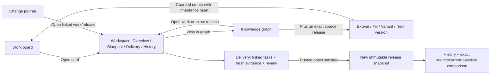

# Singular Planning unit and flows

## Proposed DOM/lifecycle shape

```text
#workspace-planning-drawer                     host visibility/geometry owner
  section[data-devlab-id="workspace.planning"] one content/lifecycle unit
    header                                    project/context + revision/status/refresh
      navigation                              Work board | Knowledge graph | Change journal
      contextual actions                      scope/search/lens + Data / New work
    content                                   one bounded content area
      selected view                           board OR graph OR journal
      workspace inspector                     same unit: header, tabs, scroll body, footer
      nested dialog                           scoped focus/layer above current inspector
```

The user-identified `> section > section > header` path is corroborated by packaged source and absent in the inspected live unavailable state; it is a location, not a permanent nesting API. Flatten duplicate observers/board wrappers while retaining semantic IDs and the host drawer boundary. One border/background/spacing system and shared bounds bind header/body. Merge transport status into the header rather than keeping competing navigation strips.

Adapt prototype sidebar navigation into the unit; devLAB already owns brand/projects. Right-hand inspector belongs within an enlarged wide drawer; compact mode fills its content area with Back/Close. Nested modals return to their inspector action; inspector closes to the invoking card/node; Planning closes to its rail trigger. Unsaved input is guarded at every tab/view/project/import/archive/close boundary. Escape closes only the top layer.



Board/Graph/Journal share one canonical project snapshot and one command owner. View filters never affect global WIP. Graph lenses show one relationship family at a time; ownership, lineage, declared dependencies, UI/rule pins and executable agent wiring remain distinct. A plus action keeps the selected source identity and produces a Plan card; it does not execute work or clone a provider thread.

## Responsive and interaction contract

The live observed drawer is only251px tall with a252px output surface; a full-page prototype cannot be pasted there. Add Planning-specific default/enlarged/resizable bounds while retaining the rail and editing workspace. Do not borrow terminal panel resize state. Header stays visible; lane content may scroll horizontally; compact graph details move below; inspector scroll remains internal without nested competing scroll owners. Use container breakpoints at actual available width, not copied page media rules.

Test1440x900,820x900 and390x844, compact/default/enlarged heights, long names, zoom and reduced motion. Show accessible names/status for icon actions, logical tabs, keyboard card/node opening and drag alternatives. Search retains cursor on filtering. Late service responses/project switches cannot reopen old drawers or overwrite new selections. Hidden content receives no focus and stops polling; opening Planning leaves PTY processes, terminal resize ownership, preview frames and editor drafts intact.

See [evidence/ui-flow.md](evidence/ui-flow.md) and saved screenshots for observed versus proposed behavior. The live unavailable state is not accepted implementation of the prototype.

Before-navigation guard contract: project selection currently calls ProjectWorkspace.select directly. Planning must veto before the actual owner mutates, with explicit guard registration/disposal and stale async-navigation cancellation. Post-change subscription cannot preserve dirty fields. All project/output/Planning-close entrypoints participate; source override for ui-projects is reviewed and integrated serially. Expanded layout targets at least320px usable body when viewport permits, retained36px rail, keyboard resize and safe short-height overflow.
