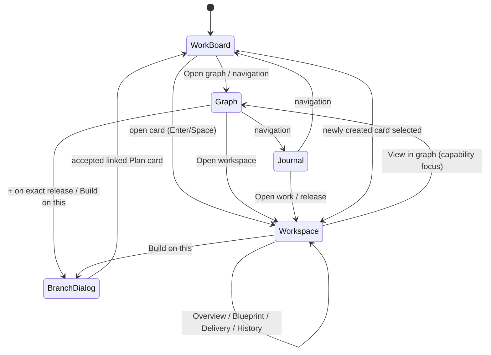

# DevTest Continuity UI/flow audit — 2026-10-31

Scope: read-only planning for `/home/creoaurea/Documents/_PROTOCOLS/DevLab-Workspace/DevTest`. No product, canonical plan, shared memory, dependencies, server lifecycle or app records were changed. One own read-only checkpoint is recorded; no invented context measurement or DONE. We holding rules. Applied ui-agent and playwright-browser skills. Target has no `.context/protocols/ui-agent.md` or CONTINOHM directory.

## Verified evidence

All four supplied previews were visually inspected: board, graph, workspace and mobile. Source audited before isolated rendering. A private sandboxed headless Chrome rendered the self-contained HTML in an in-memory document with all network blocked, then exercised navigation, graph keyboard zoom, source-release branch dialog, Escape, card keyboard opening and Blueprint selection at 1440 and 390 widths. No changes were submitted. No uncaught JavaScript errors. Imported build/tests were not executed; their “46 passed” statement remains historical evidence.

Live `127.0.0.1:4310` was separately inspected in ephemeral contexts at 1440×900 and 820×900, permitting GET only to that origin. Both Planning drawers displayed **“Planning is unavailable in this workspace.”** Each had zero nested sections and zero headers. Output panel geometry: x0/y612/height252/full viewport width; drawer x0/y613/height251; retained rail y864/height36. Thus the current loaded board/header cannot be visually accepted. `src/main.ts:19` explicitly disables `client.planning`. Live HTML and index asset exactly match on-disk dist (index SHA cb184ded0dce3d64f5712c146ffc2817e60cb396105fa2b4a77598e925457c20); this establishes served-build identity, not a fresh-source build. `localhost` Host is rejected; 127.0.0.1 succeeds.

Evidence: `/dev/shm/devtest-kanban-browser-evidence.json`, `devtest-current-planning-{1440,820}.png`, `devtest-prototype-graph-{1440,390}.png`, `devtest-prototype-workspace-{1440,390}.png`. Rendered images were inspected. No live non-GET or external requests were observed.

## Existing source boundary and integration decision

`plugins/ui-shell/src/view.tsx:172–185,699–701,944` owns Planning visibility, output lifetime, drawer ID and trigger focus restoration. Its panel uses the existing short/enlarged sizes; `.workspace-planning-drawer` scrolls (`devlab.css:845`), while packaged `.kf-planning` also owns height/scroll (`node_modules/@devlab/ui-kanban/source/src/board.css:672`). `src/shell.tsx:122` composes the planning contribution with exact ProjectWorkspace and planningVisible. Retain these host contracts and mounted preview/terminal owners.

The duplicate content is real in packaged source: `MilestoneBoard.tsx:211` outer `.kf-planning` section, transport/status row at 218, inner `.kf-board` section at 358 and independent “Plan / Segment · Milestone · SL · AT” header at 366. Current board is milestone Structure/Execution, not Continuity. Its semantic IDs and guarded actions must survive replacement/adaptation.

**One proposed integrated unit:** retain `#workspace-planning-drawer` as the host boundary, and render one named Continuity planning section inside it. That section owns one cohesive header, contextual toolbar, current body and associated panels. Flatten the observer wrapper and board wrapper into this root rather than merely removing an HTML tag. Merge project/revision/loading/refresh status with the unit’s header; remove the separate transport strip and duplicate Plan heading. One border, background, spacing rhythm and internal vertical scrolling owner visually bind these parts.

Use the prototype’s hierarchy and density: compact project/view context plus Data and New work actions; Work board / Knowledge graph / Change journal navigation and owning-module filter; then current-view controls/body. Adapt prototype left navigation into compact controls inside this existing drawer because devLAB already owns global brand/project navigation. Do not embed the complete HTML/sidebar/topbar/footer or import global `:root`, body, button, h1, media or dialog styles. Scope continuity styles and map palette/surface/text/state colors to host semantic tokens (`board.css:1–14` already demonstrates this). Preserve prototype cards, restrained badges, lanes, graph lenses, inspector layering and copy; no extra dashboard/feature invention.

## View and selection flow

Keep view, scope, search, lens, focus and selected record as presentation state, never canonical task truth. Closing inspector returns to the invoking view/card/node; closing Planning restores its host trigger. A project change clears stale selections and ignores late responses (existing generation guard `MilestoneBoard.tsx:132–208`). Prototype source anchors below use `tobeimplemented/CA_devLAB_Kanban_v2_Continuity/source/app.js`.

Work board (`:61–65`): summary, search, Ready only and owning-module filter; five lanes Plan→Queue→Process→Review→Done; concise identity/origin/task/rule/owner badges; card + creates linked work. Prototype Process limit is two, blockers gate Queue/Process, Done opens release workflow and released cards cannot reopen (`:51–57`). These are proposed domain rules requiring canonical mapping, not alternate labels for existing pending/running/review/complete statuses.

Graph (`:71–96`): Lineage / Dependencies / Rules & UI, focus menu, typed Link, pan/zoom/fit, selection plus contextual side information. At narrow drawer widths, wrap controls and place graph context below canvas as the mobile preview does (`style.css:4–5`); fit to the actual container, not viewport. Preserve exact source release when branching (`:69–70`), inherited blueprint/pinned rules and fresh tasks/proof. Variant regenerates UI IDs and clears write paths. Never map these relationships onto the existing executable agent-flow canvas.

Workspace (`:98–108`): one four-layer inspector with identity/origin/stage header, tabs, scrolling content and anchored View in graph / Agent context / Build on this footer. Match prototype right-side workspace in enlarged wide drawer; at compact widths fill the drawer’s content area, retaining clear Back/Close. Avoid nested viewport-fixed overlays escaping the host. Modals stack above the workspace only when needed.

## Interaction inventory and acceptance gaps

The mapper summary parsed four source regions without parser gaps (2,374 records, 340 semantic-ID gaps); targeted `workspace.drawer.planning` query resolves the host button and selectOutput. It excludes node_modules and imported reference files, so it cannot claim Continuity coverage. Register new stable IDs and direct handlers before acceptance.

Required inventory includes board filters/search/create/open/move; graph lens/focus/select/link/zoom/fit/branch; journal search/context/open/export; all four workspace layers; blueprint save/scope/rule create/reuse/revise/UI/decision; tasks/evidence/manual review/release; history comparison/archive/restore; context export; backup/import/conflict/error handling (`:97–128,129–172`). Backend authority/evidence validation is not implemented by the HTML.

Acceptance must cover:

- Keyboard/focus: logical tab order, visible ring, named icon controls, Enter/Space card/node actions, arrow/Home/End behavior if tablist semantics are used, graph +/−/0/arrows, modal focus containment, Escape closing only topmost layer and restoring origin, no hidden focus targets. Prototype has Enter/Space and focus trap but nested button-in-role-button cards/nodes and many unassociated labels need semantic correction.
- Drag and guarded commands: equivalent keyboard stage/parent/reorder actions; cancellation, dependency/WIP/released/read-only rejections and server revision conflicts explain reasons without moving canonical cards prematurely. Preserve existing inspector Begin/Verify/Finish/Reset and verification confirmation (`TaskInspector.tsx:86–169`) through declared command contracts.
- State handling: initial loading, stale data retained with read error, empty filters versus empty project, unavailable capability, busy/disabled commands, failed import/form validation, unsaved field protection, release gates and stale proof, cross-tab conflict pause. Announce success/error through scoped status/alert regions; never infer external test success.
- Responsive/lifecycle: verify actual 1440/820/390 and collapsed/enlarged drawer heights; only lanes scroll horizontally, no header/action clipping; graph side panel below at compact widths, inspector usable without losing context; closing/switching output retains preview frames and exact PTY/session/resize ownership. Container-based breakpoints, not copied page viewport media queries.
- Performance: hidden Planning stops polling (existing 1.2s timer cleans up at `MilestoneBoard.tsx:132–176`); no complete DOM replacement on keystrokes or graph pan; preserve search cursor/focus, bound graph neighborhood using existing lenses, and keep geometry as local view state. Measure filtering, inspector opening, pan and project switch with representative fixture sizes; set explicit budgets before implementation, no unmeasured speed claim.

## Actionable slice sequence

1. Lock the host/content contract and source acquisition for packaged ui-kanban; explicitly map Continuity records/actions to canonical planning. Resolve planning capability exposure in a disposable fixture before any live integration claim.
2. Build the single root/header/navigation/toolbar/body shell with scoped semantic styles; carry current task actions and status feedback without a duplicate transport header.
3. Adapt board and four-layer workspace, then graph and journal against the same authoritative snapshot/command boundary; preserve lineage, release and inheritance semantics.
4. Complete keyboard/focus, drag alternatives, responsive layering, errors, unsaved-data protection and lifecycle cleanup; query fresh semantic inventory.
5. Verify combined fixture interactions, gates, accessibility, conflict/failure paths, sizes and retained previews/terminals; compare against all four supplied previews and record exact deviations. Canonical plan/memory reconciliation belongs to parent.
